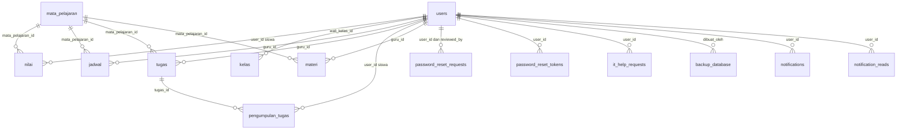

# LAPORAN PROYEK WEBSITE

## SASKANSA (Sistem Akademik Sekolah)

### Tahap 5 — Pembuatan Database

---

## 1. HALAMAN JUDUL

<div align="center">

**LAPORAN PROYEK WEBSITE**
**"SASKANSA (Sistem Akademik Sekolah)"**
**Tahap 5: Pembuatan Database**

<br>

**Disusun oleh: Kelompok 4**

| | |
|---|---|
| **Ketua** | Rahel Exsella Valentina (21) |
| **Anggota** | Ardan Ramadhan Putra Hidayat (03) |
| | Rahel Exsella Valentina (21) |
| | Satrya Bimantara (27) |
| **Kelas** | XII-RPL |
| **Guru Pembimbing** | Veny Wulandari |

<br>

**Jurusan Rekayasa Perangkat Lunak**
**SMK Negeri 1 Purwosari**
**Pasuruan**
**2026**

</div>

> **Catatan:** Identitas pada halaman judul bersumber dari dokumen *Laporan Perancangan UI/UX Website "Sistem Akademik Sekolah"* (Kelompok 4, Kelas XII-RPL) dan konfirmasi ketua kelompok.

---

## 2. KATA PENGANTAR

<br>

Dengan segala kerendahan hati, kami panjatkan puji dan syukur ke hadirat Tuhan Yang Maha Esa, karena atas berkat dan rahmat-Nya laporan proyek website berjudul **"SASKANSA (Sistem Akademik Sekolah) — Tahap 5: Pembuatan Database"** dapat diselesaikan dengan baik.

Laporan ini disusun sebagai tuntutan akademik mata pelajaran pemrograman web dan rekayasa perangkat lunak kelas XII Rekayasa Perangkat Lunak, sekaligus sebagai bagian dari LKPD 3 – Proyek Website Tahap 5: Pembuatan Database. Laporan ini merangkum analisis sistem, proses pembuatan basis data, implementasi, hingga pengujian yang benar-benar diterapkan pada proyek SASKANSA.

Kami menyadari bahwa laporan ini masih jauh dari kesempurnaan, baik dari segi isi maupun penyusunannya. Oleh karena itu, kami mengharapkan kritik dan saran yang membangun dari semua pihak, terutama Bapak/Ibu guru pembimbing, agar ke depannya laporan ini dapat lebih baik.

Kami juga mengucapkan terima kasih kepada:

1. Bapak/Ibu Kepala SMK Negeri 1 Purwosari Pasuruan, yang telah memberikan sarana dan prasarana selama penyelenggaraan proyek.
2. Bapak **Veny Wulandari** selaku guru pembimbing, yang telah memberikan bimbingan, arahan, dan masukan selama pengerjaan proyek ini.
3. Seluruh pihak yang tidak dapat kami sebutkan satu per satu, yang telah membantu dalam penyusunan laporan ini.

Semoga laporan ini dapat memberikan manfaat bagi pembaca, khususnya bagi pengembang sistem akademik di lingkungan sekolah.

<br>

...................................., ..............................

&nbsp;&nbsp;&nbsp;&nbsp;&nbsp;&nbsp;&nbsp;&nbsp;&nbsp;&nbsp;&nbsp;&nbsp;&nbsp;&nbsp;&nbsp;&nbsp;Ketua Kelompok 4,

<br>
<br>
<br>

&nbsp;&nbsp;&nbsp;&nbsp;&nbsp;&nbsp;&nbsp;&nbsp;&nbsp;&nbsp;&nbsp;&nbsp;&nbsp;&nbsp;&nbsp;&nbsp;**(Rahel Exsella Valentina)**

---

## 3. DAFTAR ISI

1. Halaman Judul
2. Kata Pengantar
3. Daftar Isi
4. BAB I — Pendahuluan
   - 1.1 Latar Belakang
   - 1.2 Identifikasi Masalah
   - 1.3 Rumusan Masalah
   - 1.4 Tujuan Proyek
   - 1.5 Manfaat Proyek
   - 1.6 Batasan Proyek
5. BAB II — Analisis dan Perancangan Sistem
   - 2.1 Gambaran Umum SASKANSA
   - 2.2 Tujuan Sistem
   - 2.3 Kebutuhan Fungsional
   - 2.4 Kebutuhan Nonfungsional
   - 2.5 Aktor dan Hak Akses
   - 2.6 Alur Kerja Sistem
   - 2.7 Perancangan ERD dan Relasi Basis Data
6. BAB III — Pembuatan Database
   - 3.1 Tujuan Pembelajaran
   - 3.2 Alat dan Bahan
   - 3.3 Keselamatan dan Keamanan Kerja
   - 3.4 Langkah Pembuatan Database
   - 3.5 Nama Database yang Digunakan
   - 3.6 Daftar Tabel dan Fungsinya
   - 3.7 Struktur Kolom, Tipe Data, Primary Key, dan Foreign Key
   - 3.8 Relasi Antartabel
   - 3.9 Penggunaan Migration
   - 3.10 Data Awal (Dummy Data)
   - 3.11 Integritas Data
   - 3.12 Prosedur Backup dan Restore Database
7. BAB IV — Implementasi dan Hasil
   - 4.1 Implementasi Halaman dan Menu
   - 4.2 Implementasi Basis Data pada Laravel
   - 4.3 Implementasi Fitur Utama
   - 4.4 Hasil Pengujian
   - 4.5 Analisis Hasil
8. BAB V — Pembahasan
   - 5.1 Analisis Terhadap LKPD
   - 5.2 Pembahasan Konsep yang Dipakai
   - 5.3 Kendala dan Solusi
   - 5.4 Saran Pengembangan Selanjutnya
   - 5.5 Kesimpulan Keseluruhan
9. BAB VI — Daftar Pustaka
10. Lampiran
    - Lampiran A — Daftar Berkas Proyek
    - Lampiran B — Struktur Tabel (DDL)
    - Lampiran C — Daftar Tabel dan Jumlah Baris Data
    - Lampiran D — Bukti Pengujian
    - Lampiran E — Aset yang Digunakan
    - Lampiran F — Daftar Perintah yang Digunakan

---

## 4. BAB I — PENDAHULUAN

### 1.1 Latar Belakang

Pengelolaan informasi akademik di sekolah masih banyak dilakukan secara manual: nilai dicatat pada buku induk, jadwal disusun pada kertas terpisah, tugas dan materi tersebar di berbagai kanal, serta arsip data siswa dan guru disimpan dalam berkas yang sulit dicari kembali. Cara tersebut rentan terhadap kesalahan pencatatan, duplikasi data, kehilangan data, dan keterlambatan penyebaran informasi kepada pihak yang membutuhkan.

SASKANSA (Sistem Akademik Sekolah) hadir sebagai website pengelolaan akademik yang menyediakan data secara terpusat dan terbagi sesuai hak akses penggunanya. Sistem ini terdiri atas tiga peran, yaitu **Admin** yang mengelola data dasar dan backup database, **Guru** yang mengelola nilai dan laporan pembelajaran, serta **Siswa** yang mengakses informasi akademik seperti jadwal, tugas, materi, riwayat nilai, dan rapor.

Proyek ini dikembangkan secara bertahap mengikuti LKPD 3 – Proyek Website. Pada **Tahap 5: Pembuatan Database**, fokus pengerjaan adalah menerjemahkan hasil analisis dan perancangan sistem menjadi basis data yang utuh, terstruktur, berelasi, dan siap digunakan oleh aplikasi. Pembuatan database menjadi tahap penentu, karena seluruh fitur sistem — mulai dari login, input nilai, jadwal, tugas, hingga backup — bergantung pada struktur tabel, relasi, dan integritas data yang dibangun pada tahap ini.

### 1.2 Identifikasi Masalah

Berdasarkan pengamatan terhadap pengelolaan akademik sekolah dan pengembangan proyek SASKANSA, identifikasi masalah adalah sebagai berikut:

1. Data akademik (nilai, jadwal, tugas, materi) belum terpusat sehingga sulit diperbarui dan diperiksa secara cepat.
2. Belum ada pemisahan hak akses yang tegas antara Admin, Guru, dan Siswa, sehingga rentan terhadap perubahan data yang tidak sah.
3. Pencatatan nilai masih berpotensi ganda (satu siswa–mata pelajaran–periode yang sama tercatat lebih dari sekali) bila tidak dibatasi oleh aturan basis data.
4. Data kelas dan jurusan sering berubah (siswa naik kelas, alumni lulus), sehingga riwayat nilai berisiko ikut berubah bila hanya menumpang pada tabel siswa.
5. Belum tersedia prosedur pencadangan data yang mudah dilakukan oleh admin sekolah.
6. Penggunaan akun masih berisiko bila kata sandi awal sama untuk banyak pengguna dan belum ada pembatasan percobaan login yang gagal.
7. Belum ada arsip digital terstruktur untuk data master seperti guru, siswa, rombongan belajar (rombel), jurusan, dan mata pelajaran.

### 1.3 Rumusan Masalah

1. Bagaimana menerjemahkan hasil analisis dan perancangan sistem SASKANSA ke dalam struktur basis data yang lengkap, berelasi, dan memenuhi integritas data?
2. Bagaimana membangun basis data menggunakan *migration* pada framework Laravel agar struktur tabel dapat dibuat, diperbarui, dan direproduksi dengan mudah?
3. Bagaimana membagi hak akses Admin, Guru, dan Siswa pada aplikasi agar setiap pengguna hanya dapat mengakses data sesuai perannya?
4. Bagaimana menyediakan data awal (data contoh) yang realistis untuk menguji seluruh fitur sistem?
5. Bagaimana prosedur pencadangan (*backup*) dan pemulihan (*restore*) basis data pada teknologi yang digunakan proyek ini?

### 1.4 Tujuan Proyek

1. Menghasilkan basis data SASKANSA yang terstruktur, saling berelasi, dan bebas dari duplikasi data yang tidak terkendali.
2. Membuat seluruh tabel menggunakan *migration* sehingga struktur database dapat dibangun ulang kapan pun secara otomatis.
3. Menerapkan *primary key*, *foreign key*, indeks, dan batasan unik (*unique constraint*) untuk menjamin integritas data.
4. Menerapkan pembagian hak akses Admin, Guru, dan Siswa pada seluruh rute aplikasi.
5. Menyediakan data awal melalui *seeder* agar demonstrasi dan pengujian fitur dapat langsung dilakukan.
6. Menyediakan prosedur backup database yang aman dan mudah dijalankan Admin.
7. Menguji fungsi-fungsi penting sistem dengan pengujian otomatis dan memverifikasikan hasilnya.

### 1.5 Manfaat Proyek

| No | Manfaat | Penerima |
|---|---|---|
| 1 | Menjadi acuan teknis pembuatan dan pemeliharaan database SASKANSA | Pengembang / tim proyek |
| 2 | Memudahkan pengelolaan data akademik secara terpusat dan terstruktur | Admin sekolah |
| 3 | Mempercepat input, rekap, dan pelaporan nilai pembelajaran | Guru |
| 4 | Memudahkan akses informasi akademik seperti jadwal, tugas, dan rapor | Siswa |
| 5 | Menambah pengetahuan dan keterampilan praktis pemrograman web serta basis data | Penyusun (siswa XII-RPL) |
| 6 | Menjadi referensi pengembangan sistem akademik serupa di sekolah lain | Pihak sekolah / pengembang lain |

### 1.6 Batasan Proyek

Agar laporan ini fokus dan terukur, ruang lingkup proyek dibatasi sebagai berikut:

1. Sistem berbentuk **aplikasi web** (bukan aplikasi desktop maupun aplikasi seluler asli), dibangun dengan framework **Laravel** dan basis data **MySQL**.
2. Pengguna dibatasi pada **tiga peran**, yaitu Admin, Guru, dan Siswa; tidak ada peran lain seperti wali murid atau kepala sekolah.
3. Fungsionalitas sistem dibatasi pada fitur yang telah diimplementasikan: pengelolaan data master, manajemen akun, input dan rekap nilai, laporan akademik, jadwal, tugas dan materi, riwayat akademik, rapor, notifikasi dalam aplikasi, pencarian global, permintaan bantuan tim IT, serta backup database.
4. Laporan ini berfokus pada **Tahap 5 (Pembuatan Database)**, sehingga pembahasan basis data menjadi bagian utama; pembahasan implementasi disampaikan sepanjang diperlukan.
5. **Pemulihan (restore) database** tidak dibuat sebagai fitur dalam aplikasi; pemulihan dilakukan secara manual melalui phpMyAdmin atau perintah baris perintah (Bagian 3.12 dan Lampiran B).
6. Pengujian yang dilaporkan adalah pengujian otomatis yang benar-benar dijalankan pada proyek ini; pengujian manual yang belum dilakukan ditandai sebagai bagian yang **perlu dilengkapi**.
7. Tangkapan layar halaman sistem belum dilampirkan pada laporan ini dan dapat ditambahkan sebagai penyempurnaan (Bagian 5.4).

## 5. BAB II — ANALISIS DAN PERANCANGAN SISTEM

### 2.1 Gambaran Umum SASKANSA

SASKANSA adalah website sistem akademik sekolah dengan nama aplikasi `SASKANSA` (tercantum pada berkas `.env` proyek). Sistem menyediakan satu halaman publik (*landing page*), satu halaman masuk (*login*) untuk tiga peran, serta dasbor terpisah untuk masing-masing peran yang dapat diakses melalui jalur `/dashboard/admin`, `/dashboard/guru`, dan `/dashboard/siswa`.

Secara garis besar, sistem terdiri atas empat lapis:

| Lapis | Isi |
|---|---|
| Antarmuka | 57 berkas *template* Blade, dibangun dengan Tailwind CSS 4 dan Vite, ikon Lucide, serta SweetAlert2 untuk dialog |
| Aplikasi | 26 berkas *controller*, 17 model Eloquent, dan *service* pendukung (statistik nilai, ekspor XLSX, impor akun, backup, pencarian, reset password) |
| Rute & Keamanan | 90 rute terdaftar pada `routes/web.php` dan `routes/api.php`, dengan middleware `guard`, `auth`, `role:<peran>`, `jwt`, serta pembatas laju permintaan (*rate limiter*) |
| Basis data | MySQL bernama `sistem-akademik-sekolah` dengan 24 tabel aktif, dibangun oleh 29 berkas *migration*, diisi oleh *seeder* |

Sistem juga menyediakan **API autentikasi berbasis JWT** (`/api/auth/*`) untuk kebutuhan klien di luar peramban (misalnya aplikasi seluler), meskipun seluruh fitur akademik saat ini berjalan melalui halaman web.

### 2.2 Tujuan Sistem

1. Menyediakan data akademik yang terpusat dan konsisten bagi seluruh pengguna.
2. Menjamin bahwa setiap pengguna hanya mengubah dan mengakses data sesuai perannya.
3. Mempercepat pekerjaan Admin dalam mengelola data master, akun, laporan, dan pencadangan.
4. Mempercepat Guru dalam menginput dan merekap nilai beserta laporan pembelajaran.
5. Memudahkan Siswa mengikuti jadwal, tugas, materi, serta mengetahui perkembangan nilai dan rapornya sendiri.
6. Menjaga keamanan akun melalui kebijakan kata sandi, pembatasan percobaan login, dan alur reset password yang disetujui Admin.

### 2.3 Kebutuhan Fungsional

Kebutuhan fungsional disusun dari fitur yang benar-benar tersedia pada rute dan *controller* proyek.

| No | Modul | Fungsi | Pengguna |
|---|---|---|---|
| 1 | Halaman Publik | Menampilkan informasi umum sistem (beranda, fitur, manfaat, cara kerja, tentang, FAQ, ajakan) | Tamu |
| 2 | Login | Masuk ke sistem sesuai peran dengan identifier berbeda (Admin: email, Guru: NIP, Siswa: NIS) | Admin, Guru, Siswa |
| 3 | Buat Password Baru | Wajib bagi Guru dan Siswa pada kunjungan pertama (`must_change_password`) | Guru, Siswa |
| 4 | Lupa Password | Pengajuan reset password yang disetujui Admin, lalu tautan reset melalui email | Guru, Siswa |
| 5 | Dashboard | Ringkasan data sesuai peran (statistik, grafik, notifikasi, aktivitas terbaru) | Admin, Guru, Siswa |
| 6 | Data Guru | Tambah, ubah, hapus, dan ekspor data guru | Admin |
| 7 | Data Siswa | Tambah, ubah, hapus, dan ekspor data siswa; Guru dapat melihat dan mengekspor | Admin, Guru |
| 8 | Data Kelas | Kelola rombongan belajar (jurusan + tingkat) beserta wali kelas | Admin |
| 9 | Data Jurusan | Kelola daftar jurusan/paket keahlian beserta status aktif/nonaktif | Admin |
| 10 | Data Mata Pelajaran | Kelola master mata pelajaran; Guru dapat melihat beserta daftar pengampu | Admin, Guru |
| 11 | Manajemen Akun | Kelola seluruh akun, reset password, impor massal, ekspor XLSX, cetak slip kredensial | Admin |
| 12 | Pengajuan Reset Password | Menyetujui/menolak permintaan reset password guru dan siswa | Admin |
| 13 | Input Nilai | Memasukkan dan memperbarui nilai 0–100 beserta KKM per mata pelajaran yang diampu | Guru |
| 14 | Rekap Nilai | Rekap nilai per siswa/kelas/mata pelajaran beserta ekspor XLSX | Guru |
| 15 | Laporan (Guru) | Tabel laporan, sebaran nilai per rentang, dan ketuntasan KKM beserta ekspor | Guru |
| 16 | Laporan Akademik | Rekap seluruh sekolah per kelas/mata pelajaran, grafik perkembangan, ekspor XLSX | Admin |
| 17 | Backup Database | Membuat, mengunduh, dan menghapus berkas `.sql` cadangan beserta riwayatnya | Admin |
| 18 | Jadwal Pelajaran | Menampilkan jadwal mingguan rombel siswa dengan filter hari | Siswa |
| 19 | Tugas & Materi | Menampilkan tugas dan materi rombel beserta status pengumpulan pribadi | Siswa |
| 20 | Riwayat Akademik | Rekap nilai per periode dengan rata-rata dan perbandingan terhadap periode sebelumnya | Siswa |
| 21 | Rapor | Nilai seluruh mata pelajaran beserta KKM dan status ketuntasan pada periode terpilih | Siswa |
| 22 | Profil | Melihat profil dan mengganti kata sandi | Admin, Guru, Siswa |
| 23 | Notifikasi | Lonceng notifikasi dalam aplikasi (pengumuman, tugas, pengajuan reset) | Admin, Guru, Siswa |
| 24 | Pencarian Global | Pencarian lintas menu dengan cakupan data sesuai peran | Admin, Guru, Siswa |
| 25 | Hubungi Tim IT | Formulir permintaan bantuan IT pada halaman publik yang dikirim via email | Guru, Siswa |
| 26 | API JWT | Login, profil, ganti password, dan logout berbasis token | Klien API |

### 2.4 Kebutuhan Nonfungsional

| No | Aspek | Kebutuhan yang Diterapkan pada Proyek |
|---|---|---|
| 1 | Keamanan data | Kata sandi disimpan sebagai *hash* bcrypt (`BCRYPT_ROUNDS=12`); password awal disimpan terenkripsi (`Crypt`) pada kolom `initial_password` dan hanya ditampilkan sekali |
| 2 | Keamanan akses | Pembatasan percobaan login gagal (terkunci setelah 5 kali gagal dengan durasi bertingkat), pembatas laju permintaan HTTP (`throttle`), penjaga peran pada setiap rute (`role:admin/guru/siswa`) |
| 3 | Keamanan token | Token reset password disimpan dalam bentuk *hash* SHA-256, berlaku tunggal (*single use*), dan kedaluwarsa dalam 30 menit |
| 4 | Kerahasiaan backup | Berkas cadangan disimpan pada disk privat (`storage/app/private`) sehingga tidak dapat diunduh tanpa melalui rute Admin |
| 5 | Performa | Indeks pada kolom yang sering difilter/digabung, pembacaan data dalam jumlah besar memakai `chunk`, paginasi pada seluruh daftar panjang |
| 6 | Integritas | Batasan unik pada nilai per periode, pengumpulan tugas, nama jurusan, serta pasangan jurusan–kelas |
| 7 | Konsistensi | Normalisasi format kelas (misalnya `12 - 1` menjadi `12-1`) dilakukan pada model sebelum data disimpan |
| 8 | Ketersediaan | Endpoint pemeriksaan kesehatan `/up` bawaan Laravel; pesan galat ramah tanpa membocorkan struktur internal |
| 9 | Kemudahan pemakaian | Dasbor terpisah per peran, pencarian global, notifikasi, ekspor Excel, tata letak responsif mengikuti kerangka kerja Tailwind CSS |
| 10 | Keterlacakan | Riwayat backup (nama berkas, ukuran, jumlah tabel, durasi, pembuat), alamat IP pada pengajuan reset password dan permintaan bantuan IT |

### 2.5 Aktor dan Hak Akses

Aktor sistem ditetapkan oleh kolom `users.role` dengan tiga nilai: `admin`, `guru`, dan `siswa` (tanpa tabel peran terpisah).

**2.5.1 Admin**

| Hak Akses | Rute (contoh) |
|---|---|
| Melihat dasbor dan statistik sekolah | `GET /dashboard/admin` |
| Kelola data guru (tambah/ubah/hapus/ekspor) | `/dashboard/admin/data-guru` |
| Kelola data siswa (tambah/ubah/hapus/ekspor) | `/dashboard/admin/data-siswa` |
| Kelola data kelas, jurusan, mata pelajaran | `/dashboard/admin/data-kelas`, `.../data-jurusan`, `.../data-mata-pelajaran` |
| Kelola akun, reset password, impor massal, cetak slip | `/dashboard/admin/manajemen-akun` |
| Menyetujui/menolak pengajuan reset password | `/dashboard/admin/pengajuan-reset-password` |
| Melihat dan mengekspor laporan akademik | `/dashboard/admin/laporan-akademik` |
| Membuat, mengunduh, dan menghapus backup database | `/dashboard/admin/backup-database` |
| Mengubah profil dan kata sandi sendiri | `POST /dashboard/admin/profil/password` |

**2.5.2 Guru**

| Hak Akses | Rute (contoh) |
|---|---|
| Melihat dasbor dengan cakupan mata pelajaran yang diampu | `GET /dashboard/guru` |
| Melihat dan mengekspor data siswa (baca-saja) | `/dashboard/guru/data-siswa` |
| Melihat data mata pelajaran beserta pengampu | `/dashboard/guru/mata-pelajaran` |
| Menginput dan memperbarui nilai (hanya mapel yang diampu) | `/dashboard/guru/input-nilai` |
| Melihat rekap nilai beserta tiga jenis ekspor | `/dashboard/guru/rekap-nilai` |
| Melihat dan mengekspor laporan pembelajaran | `/dashboard/guru/laporan` |
| Mengubah profil dan kata sandi sendiri | `POST /dashboard/guru/profil/password` |

**2.5.3 Siswa**

| Hak Akses | Rute (contoh) |
|---|---|
| Melihat dasbor pribadi (nilai, jadwal hari ini, tugas) | `GET /dashboard/siswa` |
| Melihat jadwal pelajaran rombel sendiri | `/dashboard/siswa/jadwal-pelajaran` |
| Melihat tugas dan materi beserta status pribadi | `/dashboard/siswa/tugas-materi` |
| Melihat riwayat akademik pribadi | `/dashboard/siswa/riwayat-akademik` |
| Melihat rapor pribadi | `/dashboard/siswa/rapor` |
| Mengubah profil dan kata sandi sendiri | `POST /dashboard/siswa/profil/password` |

**2.5.4 Matriks Hak Akses Fitur**

| Fitur | Tamu | Admin | Guru | Siswa |
|---|:---:|:---:|:---:|:---:|
| Landing page & Hubungi Tim IT | ✔ | ✔ | ✔ | ✔ |
| Login | ✔ | ✔ | ✔ | ✔ |
| Pengajuan lupa password | ✔ | – | ✔ | ✔ |
| Buat password baru (kunjungan pertama) | – | – | ✔ | ✔ |
| Data guru (CRUD + ekspor) | – | ✔ | – | – |
| Data siswa (CRUD + ekspor) | – | ✔ | lihat + ekspor | – |
| Data kelas / jurusan (CRUD + ekspor) | – | ✔ | – | – |
| Data mata pelajaran | – | ✔ (CRUD) | lihat + ekspor | – |
| Manajemen akun & impor massal | – | ✔ | – | – |
| Pengajuan reset password (persetujuan) | – | ✔ | – | – |
| Input nilai | – | – | ✔ | – |
| Rekap nilai & laporan guru | – | – | ✔ | – |
| Laporan akademik sekolah | – | ✔ | – | – |
| Backup database | – | ✔ | – | – |
| Jadwal, tugas & materi, riwayat, rapor | – | – | – | ✔ |
| Profil & ganti password | – | ✔ | ✔ | ✔ |
| Notifikasi & pencarian global | – | ✔ | ✔ | ✔ |
| API JWT (login/profil/ganti password) | ✔ (login) | ✔ | ✔ | ✔ |

### 2.6 Alur Kerja Sistem

**2.6.1 Alur Login**

1. Pengguna membuka `GET /login`, memilih peran (Admin/Guru/Siswa), lalu mengisi identifier sesuai peran (email, NIP, atau NIS) dan kata sandi.
2. Sistem memeriksa pembatasan percobaan login gagal pada tabel `login_attempts` dengan kunci `peran:identifier` (sehingga NIP guru dan NIS siswa yang sama tidak saling mengunci).
3. Sistem mencari pengguna dengan kueri `WHERE role = ? AND <identifier> = ?`, memeriksa status akun (`is_active`), lalu memvalidasi kata sandi dengan `Hash::check`.
4. Bila berhasil, sesi dibuat untuk guard peran tersebut dan token JWT disimpan pada sesi; pengguna diarahkan ke dasbor sesuai peran.
5. Bila Guru/Siswa masih memiliki tanda `must_change_password`, pengguna diarahkan ke halaman `GET /ubah-password` sebelum masuk dasbor.

```mermaid
flowchart TD
    A[Buka /login] --> B[Pilih peran + isi identifier + kata sandi]
    B --> C{Cek kunci lockout<br/>login_attempts}
    C -->|Terkunci| D[Pesan 429: coba lagi nanti]
    C -->|Tidak terkunci| E{Cari user<br/>role + identifier}
    E -->|Tidak ditemukan / salah| F[Pesan gagal + catat percobaan]
    E -->|Ditemukan| G{Akun aktif?}
    G -->|Tidak| H[Pesan akun tidak aktif]
    G -->|Ya| I{must_change_password?}
    I -->|Ya (guru/siswa)| J[Halaman ubah password]
    J --> K[Dasbor peran]
    I -->|Tidak| K
    F --> B
```

**2.6.2 Alur Reset Password (berpersetujuan Admin)**

1. Guru/Siswa mengajukan permintaan melalui `POST /lupa-password`; sistem membuat baris `password_reset_requests` berstatus `pending` dan selalu menampilkan pesan umum agar identifier tidak bisa ditebak.
2. Admin membuka `/dashboard/admin/pengajuan-reset-password`, lalu **menyetujui** (menerbitkan token) atau **menolak** (dengan alasan).
3. Saat disetujui, sistem menyimpan *hash* token pada `password_reset_tokens`, mengirim tautan reset ke email pengguna, dan menandai peninjau (`reviewed_by`, `reviewed_at`).
4. Pengguna membuka `GET /reset-password/{token}`, memasukkan kata sandi baru sesuai kebijakan (minimal 8 karakter, berisi huruf besar dan angka), lalu token ditandai terpakai dan sesi lama dikeluarkan.

**2.6.3 Alur Input Nilai (Guru)**

1. Guru membuka `GET /dashboard/guru/input-nilai`; sistem hanya menampilkan mata pelajaran yang tercatat pada kolom `users.mata_pelajaran` guru tersebut dan daftar siswa aktif yang memiliki kelas.
2. Guru mengisi nilai 0–100 dan KKM; sistem memvalidasi kepemilikan mata pelajaran di sisi server.
3. Data disimpan dengan `updateOrCreate` pada kunci unik `(user_id, mata_pelajaran_id, tahun_ajaran, semester)` di dalam satu transaksi, sehingga input ulang memperbarui baris yang sama.
4. Sel kelas yang dikosongkan akan menghapus baris nilai terkait.

**2.6.4 Alur Backup Database (Admin)**

1. Admin membuka `/dashboard/admin/backup-database` dan menekan tombol **Buat Backup** (opsional: menambahkan catatan).
2. `DatabaseBackupService` mengunci proses dengan `Cache::lock`, lalu menulis berkas `.sql` berisi struktur dan seluruh isi tabel (kecuali tabel sistem yang dibuang) ke disk privat.
3. Metadata backup (nama berkas, ukuran, jumlah tabel, durasi, pembuat) dicatat pada tabel `backup_database`, lalu riwayat dipangkas sesuai batas `BACKUP_KEEP`.
4. Admin dapat mengunduh atau menghapus riwayat backup; pemulihan dilakukan manual (Bagian 3.12).

**2.6.5 Alur Permintaan Bantuan IT**

Tamu/pengguna mengisi formulir "Hubungi Tim IT Sekolah" pada landing page (`POST /hubungi-tim-it`, dibatasi 5 kali per menit dan dilindungi *honeypot*). Data tersimpan pada `it_help_requests` berstatus `baru` dan dikirim ke email tim IT bila `IT_SUPPORT_EMAIL` dikonfigurasi.

### 2.7 Perancangan ERD dan Relasi Basis Data

ERD berikut disusun berdasarkan *foreign key* yang benar-benar ada pada migration dan struktur database proyek.



**Catatan relasi tanpa *foreign key* (desain tersendiri):**

1. `kelas.jurusan` dan `users.jurusan` menyimpan **nama jurusan** (teks) yang sama dengan `jurusan.nama`, bukan `jurusan.id`, sehingga tidak dibuat kunci asing; kecocokan nama dijaga oleh aplikasi.
2. `users.kelas` menyimpan format kelas (misalnya `12-1`) dan dihubungkan ke `kelas.kelas` secara tekstual; model `KelasRombel` menyediakan relasi `siswa` dengan kunci pemilik berupa teks kelas.
3. Tabel `jadwal`, `tugas`, dan `materi` menyimpan salinan `kelas` + `jurusan` (denormalisasi ringan) agar data tetap terbaca bila rombel siswa berubah.
4. Tabel `nilai` menyimpan salinan `kelas` + `jurusan` pada saat nilai dicatat, agar riwayat nilai tidak berubah ketika siswa naik kelas.
5. Tabel `sessions`, `login_attempts`, dan `personal_access_tokens` tidak memiliki kunci asing ke `users` (penyimpanan bersifat teknis).

## 6. BAB III — PEMBUATAN DATABASE

> Bagian utama laporan ini, sesuai LKPD 3 – Proyek Website **Tahap 5: Pembuatan Database**.

### 3.1 Tujuan Pembelajaran

Setelah menyelesaikan tahap pembuatan database, peserta didik diharapkan mampu:

1. Menerjemahkan kebutuhan fungsional sistem menjadi daftar tabel, kolom, dan relasi yang sesuai.
2. Membuat tabel menggunakan perintah `php artisan make:migration` dan menyusun definisi kolom beserta tipe datanya pada Laravel *Schema Builder*.
3. Menerapkan `primary key`, `foreign key` dengan pilihan aksi (`cascade`/`set null`), batasan unik, dan indeks untuk menjamin integritas serta performa data.
4. Menjalankan migrasi (`php artisan migrate`), memeriksa hasilnya pada MySQL, dan mengelola riwayat migrasi melalui tabel `migrations`.
5. Mengisi data awal melalui *seeder* sehingga aplikasi dapat langsung diuji.
6. Menjelaskan struktur setiap tabel, fungsinya, dan relasinya kepada pihak lain (dokumentasi).
7. Melakukan backup database secara teratur dan memahami prosedur pemulihannya.

### 3.2 Alat dan Bahan

**Alat (perangkat keras):**

| No | Alat | Keterangan |
|---|---|---|
| 1 | Komputer/laptop | Spesifikasi minimal mengikuti kebutuhan PHP 8.3 dan MySQL |
| 2 | Jaringan internet | Untuk instalasi *dependency* Composer, npm, dan akses dokumentasi |

**Bahan (perangkat lunak):**

| No | Perangkat Lunak | Versi pada Proyek | Fungsi |
|---|---|---|---|
| 1 | Visual Studio Code | – | Editor kode sumber |
| 2 | PHP | ^8.3 | Bahasa pemrograman sisi server |
| 3 | Composer | – | Manajer paket PHP (`composer.json`, `composer.lock`) |
| 4 | Laravel | ^13.8 (terpasang 13.24.0) | Framework aplikasi web |
| 5 | MySQL / MariaDB | Koneksi `127.0.0.1:3308` | Server basis data |
| 6 | phpMyAdmin / MySQL CLI | – | Pemeriksaan struktur dan pemulihan cadangan |
| 7 | Node.js + npm | Vite 8, Tailwind CSS 4 | Perakit aset CSS/JS |
| 8 | Git | – | Penyimpanan versi sumber |
| 9 | PHPUnit | ^12.5 | Kerangka pengujian otomatis |

### 3.3 Keselamatan dan Keamanan Kerja

1. **Keselamatan peralatan:** komputer diletakkan di permukaan datar dan stabil, kabel daya tidak dilalui orang, dan pekerjaan dihentikan bila terjadi gangguan listrik untuk menghindari kerusakan data.
2. **Kerapian ruang kerja:** berkas proyek disimpan terorganisasi dalam satu folder repositori agar mudah dicadangkan dan dilacak perubahannya.
3. **Keamanan akun:** kata sandi akun pengembang dan kunci rahasia (seperti `APP_KEY` dan `JWT_SECRET` pada berkas `.env`) **tidak dibagikan** kepada orang lain dan tidak dimasukkan ke dalam repositori (berkas `.env` masuk daftar aba-akan `.gitignore`).
4. **Keamanan data sekolah:** pada berkas `.env.example` tercatat peringatan agar berkas cadangan database **tidak** disimpan pada disk publik karena isinya seluruh data sekolah; backup disimpan pada `storage/app/private`.
5. **Cadangan sebelum perubahan:** sebelum menjalankan perubahan skema atau *seeder* pada basis data berisi data penting, lakukan backup terlebih dahulu melalui menu **Admin ▸ Backup Database** (Bagian 3.12).
6. **Pengujian terpisah:** pengujian otomatis dijalankan pada basis data SQLite di memori (`phpunit.xml`), bukan pada basis data produksi, sehingga data nyata tidak terganggu.
7. **Kata sandi awal:** password awal akun dibuat unik per pengguna oleh sistem, disimpan terenkripsi, dan wajib diganti pada kunjungan pertama.
8. **Berkas rahasia:** jangan menyalin berkas `.env` ke perangkat lain tanpa keperluan; nilai `JWT_SECRET` pada proyek ini sengaja tidak dicantumkan dalam laporan.

### 3.4 Langkah Pembuatan Database

Langkah berikut adalah alur kerja yang benar-benar dipakai pada proyek SASKANSA.

**Langkah 1 — Menyiapkan proyek dan koneksi basis data**

```bash
composer install
copy .env.example .env        # Windows: salin .env.example menjadi .env
php artisan key:generate
```

Kemudian isi koneksi basis data pada berkas `.env` (lihat Bagian 3.5).

**Langkah 2 — Membuat berkas migration**

```bash
php artisan make:migration create_nilai_table
```

Berkas hasil pembuatan tersimpan pada folder `database/migrations/` dengan nama berformat `YYYY_MM_DD_HHMMSS_nama_tabel.php`. Di dalamnya terdapat dua metode: `up()` untuk membuat/menambah tabel, dan `down()` untuk mengembalikan perubahan (dipakai oleh `migrate:rollback`).

**Langkah 3 — Mendefinisikan struktur tabel**

Definisi ditulis dengan Laravel *Schema Builder*, contohnya tabel `nilai`:

```php
Schema::create('nilai', function (Blueprint $table) {
    $table->id();                                                  // PK otomatis
    $table->foreignId('user_id')->constrained('users')->cascadeOnDelete();
    $table->foreignId('mata_pelajaran_id')->constrained('mata_pelajaran')->cascadeOnDelete();
    $table->string('kelas', 30);
    $table->string('jurusan', 120);
    $table->string('tahun_ajaran', 9);
    $table->string('semester', 10);
    $table->decimal('nilai', 5, 2);
    $table->decimal('kkm', 5, 2);
    $table->timestamps();
    $table->unique(['user_id', 'mata_pelajaran_id', 'tahun_ajaran', 'semester'],
        'nilai_siswa_mapel_periode_unik');
    $table->index(['tahun_ajaran', 'semester'], 'nilai_periode_index');
    $table->index(['kelas', 'jurusan'], 'nilai_kelas_jurusan_index');
});
```

**Langkah 4 — Menjalankan migration**

```bash
php artisan migrate                 # jalankan semua migration yang belum berjalan
php artisan migrate:status          # lihat daftar status migration
php artisan migrate:rollback        # batalkan migration terakhir (batch)
```

**Langkah 5 — Mengisi data awal**

```bash
php artisan db:seed                          # jalankan seluruh seeder (DatabaseSeeder)
php artisan db:seed --class=GuruSeeder       # jalankan satu seeder tertentu
```

**Langkah 6 — Memverifikasi**

Periksa struktur tabel melalui phpMyAdmin atau `php artisan migrate:status`, lalu cek aplikasi melalui `php artisan serve` dan uji rute-rute utama.

### 3.5 Nama Database yang Digunakan

Konfigurasi koneksi pada berkas `.env` proyek:

| Parameter | Nilai |
|---|---|
| `DB_CONNECTION` | `mysql` |
| `DB_HOST` | `127.0.0.1` |
| `DB_PORT` | `3308` |
| **`DB_DATABASE`** | **`sistem-akademik-sekolah`** |
| `DB_USERNAME` | `root` |
| `DB_PASSWORD` | (dikosongkan pada lingkungan pengembangan) |
| Charset / Collation | `utf8mb4` / `utf8mb4_unicode_ci` |

Keterangan tambahan:

1. Nama basis data pada Linux bersifat **case-sensitive**, sehingga sebaiknya sama persis dengan nilai `DB_DATABASE`.
2. Berkas `.env.example` bawaan proyek memakai `sqlite`; nilai pada tabel di atas adalah kondisi nyata penggunaan proyek.
3. Pengujian otomatis memakai SQLite di memori (`DB_DATABASE=:memory:` pada `phpunit.xml`), terpisah dari basis data MySQL di atas.
4. Menurut tabel `migrations`, **seluruh 29 berkas migration telah dijalankan** pada basis data ini (terakhir `2026_10_20_130000_create_notification_reads_table.php` yang dieksekusi pada 21 Oktober 2026 melalui `php artisan migrate`).

### 3.6 Daftar Tabel dan Fungsinya

Pada kondisi basis data saat laporan ini disusun (21 Oktober 2026) terdapat **24 tabel** (23 tabel aplikasi + tabel `migrations` sebagai buku catatan migrasi).

**Tabel aplikasi utama (data sekolah):**

| No | Nama Tabel | Fungsi |
|---|---|---|
| 1 | `users` | Tabel induk seluruh akun (Admin, Guru, Siswa) beserta peran, identifier (email/NIP/NIS), status, dan kredensial |
| 2 | `mata_pelajaran` | Master mata pelajaran (kode dan nama) |
| 3 | `jurusan` | Master jurusan/paket keahlian beserta status aktif/nonaktif |
| 4 | `kelas` | Master rombongan belajar (jurusan + tingkat) beserta wali kelas |
| 5 | `nilai` | Penyimpanan nilai siswa per mata pelajaran per periode (tahun ajaran + semester) beserta KKM |
| 6 | `jadwal` | Jadwal pelajaran mingguan per rombel (hari, jam, mata pelajaran, guru, ruang) |
| 7 | `tugas` | Daftar tugas yang diberikan guru per rombel beserta tenggat waktu |
| 8 | `materi` | Daftar materi pembelajaran yang diberikan guru per rombel |
| 9 | `pengumpulan_tugas` | Pengumpulan tugas per siswa beserta status dan nilai |
| 10 | `pengumuman` | Pengumuman sekolah/jurusan/kelas beserta waktu tayang |

**Tabel keamanan dan akun:**

| No | Nama Tabel | Fungsi |
|---|---|---|
| 11 | `login_attempts` | Pencatatan dan penguncian percobaan login yang gagal |
| 12 | `password_reset_requests` | Pengajuan reset password guru/siswa beserta hasil persetujuan Admin |
| 13 | `password_reset_tokens` | Token reset password tersimpan sebagai *hash*, berlaku tunggal dan terbatas waktu |
| 14 | `it_help_requests` | Arsip permintaan bantuan Tim IT dari halaman publik |

**Tabel sistem dan pendukung:**

| No | Nama Tabel | Fungsi |
|---|---|---|
| 15 | `backup_database` | Riwayat backup (nama berkas, ukuran, jumlah tabel, durasi, pembuat) |
| 16 | `notifications` | Notifikasi dalam aplikasi per pengguna |
| 17 | `notification_reads` | Status "sudah dibaca" untuk item notifikasi dinamis |
| 18 | `sessions` | Penyimpanan sesi berbasis database (`SESSION_DRIVER=database`) |
| 19 | `cache` dan `cache_locks` | Penyimpanan *cache* dan kunci *cache* berbasis database |
| 20 | `jobs`, `job_batches`, `failed_jobs` | Antrian pekerjaan bawaan Laravel (`QUEUE_CONNECTION=database`) |
| 21 | `personal_access_tokens` | Token Sanctum (paket terpasang, belum dipakai aplikasi) |
| 22 | `migrations` | Buku catatan *batch* migration yang sudah dijalankan |

### 3.7 Struktur Kolom, Tipe Data, Primary Key, dan Foreign Key

Berikut struktur kolom inti. Notasi: **PK** = *primary key*, **FK** = *foreign key*, **U** = unik, **I** = indeks. Semua kolom `id` bertipe `bigint unsigned AUTO_INCREMENT`; seluruh tabel bisnis memiliki `created_at` dan `updated_at` bertipe `timestamp NULL`.

**3.7.1 `users`**

| Kolom | Tipe | Null | Kunci | Keterangan |
|---|---|:---:|---|---|
| `id` | `bigint unsigned AI` | – | **PK** | Kunci utama |
| `name` | `varchar(255)` | – | – | Nama pengguna |
| `email` | `varchar(255)` | ✔ | **U** | Identifier login Admin (juga diisi seluruh pengguna) |
| `password` | `varchar(255)` | – | – | Kata sandi ter-*hash* bcrypt |
| `role` | `varchar(255)` | – | – | Default `'siswa'`; nilai: `admin` / `guru` / `siswa` |
| `kelas` | `varchar(255)` | ✔ | – | Rombel siswa (misalnya `12-1`) |
| `nip` | `varchar(255)` | ✔ | – | Identifier login Guru |
| `nis` | `varchar(255)` | ✔ | – | Identifier login Siswa |
| `jurusan` | `varchar(255)` | ✔ | – | Nama jurusan (teks, mengikuti `jurusan.nama`) |
| `mata_pelajaran` | `varchar(255)` | ✔ | – | Nama mata pelajaran yang diampu guru |
| `is_active` | `tinyint(1)` | – | – | Default `1`; menentukan apakah akun bisa masuk |
| `status` | `varchar(255)` | – | **I** | Default `'Aktif'`; nilai `Aktif` / `Nonaktif` / `Lulus` |
| `initial_password` | `text` | ✔ | – | Kata sandi awal terenkripsi (`Crypt`), ditampilkan sekali |
| `must_change_password` | `tinyint(1)` | – | – | Default `1`; memaksa ganti password pada login pertama |
| `remember_token` | `varchar(100)` | ✔ | – | Token "ingat saya" bawaan Laravel |

**3.7.2 `kelas` (model `KelasRombel`)**

| Kolom | Tipe | Null | Kunci | Keterangan |
|---|---|:---:|---|---|
| `id` | `bigint unsigned AI` | – | **PK** | – |
| `jurusan` | `varchar(120)` | – | – | Nama jurusan (teks) |
| `kelas` | `varchar(30)` | – | – | Format kelas (misalnya `12-1`) |
| `wali_kelas_id` | `bigint unsigned` | ✔ | **FK** → `users.id` | Wali kelas (guru); `ON DELETE SET NULL` |
| – | – | – | **U** `(jurusan, kelas)` | Satu rombel unik per jurusan + kelas |

**3.7.3 `jurusan`**

| Kolom | Tipe | Null | Kunci | Keterangan |
|---|---|:---:|---|---|
| `id` | `bigint unsigned AI` | – | **PK** | – |
| `nama` | `varchar(120)` | – | **U** | Nama jurusan, tidak boleh ganda |
| `status` | `varchar(20)` | – | – | Default `'aktif'`; nilai `aktif` / `nonaktif` |

**3.7.4 `mata_pelajaran`**

| Kolom | Tipe | Null | Kunci | Keterangan |
|---|---|:---:|---|---|
| `id` | `bigint unsigned AI` | – | **PK** | – |
| `kode` | `varchar(255)` | ✔ | – | Kode mata pelajaran (misalnya `MTK`) |
| `nama` | `varchar(255)` | – | – | Nama mata pelajaran |

**3.7.5 `nilai`**

| Kolom | Tipe | Null | Kunci | Keterangan |
|---|---|:---:|---|---|
| `id` | `bigint unsigned AI` | – | **PK** | – |
| `user_id` | `bigint unsigned` | – | **FK** → `users.id` | Siswa pemilik nilai; `ON DELETE CASCADE` |
| `mata_pelajaran_id` | `bigint unsigned` | – | **FK** → `mata_pelajaran.id` | `ON DELETE CASCADE` |
| `kelas` | `varchar(30)` | – | – | Salinan kelas saat nilai dicatat |
| `jurusan` | `varchar(120)` | – | – | Salinan jurusan saat nilai dicatat |
| `tahun_ajaran` | `varchar(9)` | – | – | Contoh `2026/2027` |
| `semester` | `varchar(10)` | – | – | `Ganjil` / `Genap` |
| `nilai` | `decimal(5,2)` | – | – | Nilai 0–100 |
| `kkm` | `decimal(5,2)` | – | – | Batas ketuntasan |
| – | – | – | **U** `(user_id, mata_pelajaran_id, tahun_ajaran, semester)` | Nama indeks `nilai_siswa_mapel_periode_unik` |
| – | – | – | **I** | `nilai_periode_index`, `nilai_kelas_jurusan_index`, `nilai_mata_pelajaran_index` |

**3.7.6 `jadwal`**

| Kolom | Tipe | Null | Kunci | Keterangan |
|---|---|:---:|---|---|
| `id` | `bigint unsigned AI` | – | **PK** | – |
| `kelas` | `varchar(30)` | – | – | Rombel tujuan |
| `jurusan` | `varchar(120)` | ✔ | – | Kosong = berlaku untuk semua jurusan pada kelas tersebut |
| `hari` | `varchar(10)` | – | – | Senin–Sabtu |
| `jam_mulai` / `jam_selesai` | `time` | – | – | Rentang jam pelajaran |
| `mata_pelajaran_id` | `bigint unsigned` | – | **FK** → `mata_pelajaran.id` | `ON DELETE CASCADE` |
| `guru_id` | `bigint unsigned` | ✔ | **FK** → `users.id` | Pengampu; `ON DELETE SET NULL` |
| `ruang` | `varchar(60)` | ✔ | – | Ruang kelas |
| – | – | – | **I** | `jadwal_kelas_jurusan_index`, `jadwal_hari_index` |

**3.7.7 `tugas`**

| Kolom | Tipe | Null | Kunci | Keterangan |
|---|---|:---:|---|---|
| `id` | `bigint unsigned AI` | – | **PK** | – |
| `kelas` | `varchar(30)` | – | – | Rombel tujuan |
| `jurusan` | `varchar(120)` | ✔ | – | Kosong = semua jurusan |
| `mata_pelajaran_id` | `bigint unsigned` | – | **FK** → `mata_pelajaran.id` | `ON DELETE CASCADE` |
| `guru_id` | `bigint unsigned` | ✔ | **FK** → `users.id` | `ON DELETE SET NULL` |
| `judul` | `varchar(255)` | – | – | Judul tugas |
| `deskripsi` | `text` | ✔ | – | Deskripsi tugas |
| `deadline` | `datetime` | ✔ | **I** | Tenggat pengumpulan |
| – | – | – | **I** | `tugas_kelas_jurusan_index`, `tugas_deadline_index` |

**3.7.8 `materi`**

| Kolom | Tipe | Null | Kunci | Keterangan |
|---|---|:---:|---|---|
| `id` | `bigint unsigned AI` | – | **PK** | – |
| `kelas` | `varchar(30)` | – | – | Rombel tujuan |
| `jurusan` | `varchar(120)` | ✔ | – | Kosong = semua jurusan |
| `mata_pelajaran_id` | `bigint unsigned` | – | **FK** → `mata_pelajaran.id` | `ON DELETE CASCADE` |
| `guru_id` | `bigint unsigned` | ✔ | **FK** → `users.id` | `ON DELETE SET NULL` |
| `judul` | `varchar(255)` | – | – | Judul materi |
| `deskripsi` | `text` | ✔ | – | Uraian materi |
| `tanggal` | `date` | ✔ | – | Tanggal materi diberikan |

**3.7.9 `pengumpulan_tugas`**

| Kolom | Tipe | Null | Kunci | Keterangan |
|---|---|:---:|---|---|
| `id` | `bigint unsigned AI` | – | **PK** | – |
| `tugas_id` | `bigint unsigned` | – | **FK** → `tugas.id` | `ON DELETE CASCADE` |
| `user_id` | `bigint unsigned` | – | **FK** → `users.id` | Siswa pengumpul; `ON DELETE CASCADE` |
| `dikumpulkan_at` | `datetime` | ✔ | – | Waktu pengumpulan |
| `status` | `varchar(20)` | – | – | Default `'dikumpulkan'`; nilai `dikumpulkan` / `dinilai` |
| `nilai` | `decimal(5,2)` | ✔ | – | Nilai tugas (bila sudah dinilai) |
| – | – | – | **U** `(tugas_id, user_id)` | Nama indeks `pengumpulan_tugas_unik` |

**3.7.10 `pengumuman`**

| Kolom | Tipe | Null | Kunci | Keterangan |
|---|---|:---:|---|---|
| `id` | `bigint unsigned AI` | – | **PK** | – |
| `judul` | `varchar(255)` | – | – | Judul pengumuman |
| `isi` | `text` | – | – | Isi pengumuman |
| `kelas` | `varchar(30)` | ✔ | – | Sasaran kelas (kosong = semua) |
| `jurusan` | `varchar(120)` | ✔ | – | Sasaran jurusan (kosong = semua) |
| `publish_at` | `datetime` | ✔ | **I** | Waktu tayang; digunakan scope `terbit` |

**3.7.11 Tabel keamanan dan pendukung (ringkas)**

| Tabel | Kolom Penting | Kunci |
|---|---|---|
| `login_attempts` | `email` (menyimpan kunci `peran:identifier`), `attempts`, `locked_until` | PK `id`, U `email` |
| `password_reset_requests` | `user_id`, `role`, `identifier`, `status` (`pending`/`approved`/`rejected`), `reviewed_by`, `reviewed_at`, `rejection_reason`, `ip_address` | PK `id`, FK `user_id` (CASCADE), FK `reviewed_by` (SET NULL), I `(user_id, status)`, I `(role, identifier)` |
| `password_reset_tokens` | `user_id`, `token_hash` (SHA-256), `expires_at`, `used_at`, `ip_address` | PK `id`, FK `user_id` (CASCADE), U `token_hash` |
| `it_help_requests` | `user_id`, `role`, `identifier`, `email`, `pesan`, `status` (`baru`/`diproses`/`selesai`), `ip_address` | PK `id`, FK `user_id` (SET NULL), I `(status, created_at)` |
| `backup_database` | `nama_file`, `driver`, `database`, `ukuran_bytes`, `jumlah_tabel`, `durasi_detik`, `catatan`, `dibuat_oleh` | PK `id`, FK `dibuat_oleh` (SET NULL), I `created_at` |
| `notifications` | `user_id`, `role`, `type`, `title`, `message`, `icon`, `url`, `read_at` | PK `id`, FK `user_id` (CASCADE) |
| `notification_reads` | `user_id`, `item_key`, `read_at` | PK `id`, FK `user_id` (CASCADE), U `(user_id, item_key)` |
| `sessions` | `id` (`varchar` PK), `user_id` (indeks, tanpa FK), `payload`, `last_activity` | PK `id` |

Definisi SQL lengkap seluruh tabel (hasil `SHOW CREATE TABLE` dari basis data nyata) disajikan pada **Lampiran B**.

### 3.8 Relasi Antartabel

| No | Relasi | Jenis | Kolom Penyambung | Aksi Saat Baris Induk Dihapus |
|---|---|---|---|---|
| 1 | `users` → `nilai` | One-to-Many | `nilai.user_id` | `CASCADE` (nilai ikut terhapus) |
| 2 | `mata_pelajaran` → `nilai` | One-to-Many | `nilai.mata_pelajaran_id` | `CASCADE` |
| 3 | `users` → `kelas` (wali kelas) | One-to-Many | `kelas.wali_kelas_id` | `SET NULL` (rombel tetap ada) |
| 4 | `mata_pelajaran` → `jadwal` | One-to-Many | `jadwal.mata_pelajaran_id` | `CASCADE` |
| 5 | `users` → `jadwal` (guru) | One-to-Many | `jadwal.guru_id` | `SET NULL` |
| 6 | `mata_pelajaran` → `tugas` | One-to-Many | `tugas.mata_pelajaran_id` | `CASCADE` |
| 7 | `users` → `tugas` (guru) | One-to-Many | `tugas.guru_id` | `SET NULL` |
| 8 | `tugas` → `pengumpulan_tugas` | One-to-Many | `pengumpulan_tugas.tugas_id` | `CASCADE` |
| 9 | `users` → `pengumpulan_tugas` | One-to-Many | `pengumpulan_tugas.user_id` | `CASCADE` |
| 10 | `mata_pelajaran` → `materi` | One-to-Many | `materi.mata_pelajaran_id` | `CASCADE` |
| 11 | `users` → `materi` (guru) | One-to-Many | `materi.guru_id` | `SET NULL` |
| 12 | `users` → `password_reset_requests` | One-to-Many | `password_reset_requests.user_id` | `CASCADE` |
| 13 | `users` (Admin peninjau) → `password_reset_requests` | One-to-Many | `password_reset_requests.reviewed_by` | `SET NULL` |
| 14 | `users` → `password_reset_tokens` | One-to-Many | `password_reset_tokens.user_id` | `CASCADE` |
| 15 | `users` → `it_help_requests` | One-to-Many | `it_help_requests.user_id` | `SET NULL` (bisa tamu) |
| 16 | `users` → `backup_database` | One-to-Many | `backup_database.dibuat_oleh` | `SET NULL` |
| 17 | `users` → `notifications` | One-to-Many | `notifications.user_id` | `CASCADE` |
| 18 | `users` → `notification_reads` | One-to-Many | `notification_reads.user_id` | `CASCADE` |
| 19 | `jurusan` ↔ `kelas` / `users` | Tekstual (tanpa FK) | Nama jurusan | Dijaga aplikasi (larangan menghapus jurusan yang masih dipakai) |
| 20 | `users.kelas` ↔ `kelas.kelas` | Tekstual (tanpa FK) | Format kelas | Dijaga aplikasi (larangan mengubah/menghapus kelas berpenghuni) |

### 3.9 Penggunaan Migration

*Migration* adalah cara Laravel mendeskripsikan perubahan struktur basis data dalam bentuk kode PHP yang dapat dijalankan ulang, dicatat, dan dibatalkan.

**Prinsip yang diterapkan pada proyek ini:**

1. **Satu perubahan satu berkas.** Setiap perubahan skema memiliki berkas sendiri dengan stempel waktu, misalnya `2026_09_30_000000_create_kelas_table.php`.
2. **Urutan berdasarkan stempel waktu.** Laravel menjalankan berkas secara berurutan sesuai nama filenya, sehingga tabel induk (`users`, `mata_pelajaran`) otomatis dibuat sebelum tabel yang merujuknya.
3. **Idempoten.** Menjalankan `php artisan migrate` berulang tidak membuat tabel ganda; hanya migration yang belum tercatat yang dijalankan.
4. **Tercatat pada tabel `migrations`.** Setiap migration yang sukses dicatat beserta nomor *batch*-nya (pada basis data ini tercatat 28 baris untuk 29 berkas).
5. **Dapat dibatalkan.** Metode `down()` tersedia pada setiap migration sehingga `php artisan migrate:rollback` dapat mengembalikan skema.
6. **Perubahan bertahap diizinkan.** Proyek memakai migration penambahan dan penghapusan kolom (misalnya menambah `role`, `nip`, `nis`, `status` pada `users`) sehingga skema dapat berevolusi tanpa menghapus data.

**Daftar 29 berkas migration (berurutan):**

| No | Berkas | Tindakan |
|---|---|---|
| 1 | `0001_01_01_000000_create_users_table` | Buat `users`, `sessions` |
| 2 | `0001_01_01_000001_create_cache_table` | Buat `cache`, `cache_locks` |
| 3 | `0001_01_01_000002_create_jobs_table` | Buat `jobs`, `job_batches`, `failed_jobs` |
| 4 | `2026_09_21_000000_add_auth_fields_to_users_table` | Tambah `username`, `role`, `must_change_password` |
| 5 | `2026_09_21_060724_create_personal_access_tokens_table` | Buat `personal_access_tokens` |
| 6 | `2026_09_21_100000_add_kelas_and_initial_password_to_users_table` | Tambah `kelas`, `initial_password` |
| 7 | `2026_09_21_120000_make_users_email_nullable` | Sesuaikan `email` (dengan penjaga `hasColumn`) |
| 8 | `2026_09_21_130000_drop_email_from_users_table` | Hapus `email`/`email_verified_at` (dengan penjaga) |
| 9 | `2026_09_21_140000_drop_password_reset_tokens_table` | Hapus `password_reset_tokens` lama (dengan penjaga) |
| 10 | `2026_09_23_000000_add_email_and_drop_username_from_users_table` | Tambah `email` (unik, nullable), hapus `username` |
| 11 | `2026_09_23_010000_create_login_attempts_table` | Buat `login_attempts` |
| 12 | `2026_09_23_020000_add_is_active_to_users_table` | Tambah `is_active` |
| 13 | `2026_09_23_030000_create_mata_pelajaran_table` | Buat `mata_pelajaran` |
| 14 | `2026_09_23_040000_add_profile_fields_to_users_table` | Tambah `nip`, `nis`, `jurusan`, `mata_pelajaran` |
| 15 | `2026_09_29_010000_create_password_reset_requests_table` | Buat `password_reset_requests` |
| 16 | `2026_09_29_020000_create_password_reset_tokens_table` | Buat `password_reset_tokens` (desain baru) |
| 17 | `2026_09_29_030000_create_it_help_requests_table` | Buat `it_help_requests` |
| 18 | `2026_09_29_040000_add_status_to_users_table` | Tambah `status` + pembaruan data lama |
| 19 | `2026_09_30_000000_create_kelas_table` | Buat `kelas` |
| 20 | `2026_09_30_010000_create_jurusan_table` | Buat `jurusan` |
| 21 | `2026_10_01_000000_create_nilai_table` | Buat `nilai` |
| 22 | `2026_10_01_010000_create_backup_database_table` | Buat `backup_database` |
| 23 | `2026_10_15_000001_create_jadwal_table` | Buat `jadwal` |
| 24 | `2026_10_15_000002_create_tugas_table` | Buat `tugas` |
| 25 | `2026_10_15_000003_create_materi_table` | Buat `materi` |
| 26 | `2026_10_15_000004_create_pengumpulan_tugas_table` | Buat `pengumpulan_tugas` |
| 27 | `2026_10_15_000005_create_pengumuman_table` | Buat `pengumuman` |
| 28 | `2026_10_20_125717_create_notifications_table` | Buat `notifications` |
| 29 | `2026_10_20_130000_create_notification_reads_table` | Buat `notification_reads` (dijalankan 21 Okt 2026) |

**Temuan:** Pemeriksaan awal pada 21 Oktober 2026 menunjukkan 28 dari 29 berkas telah berjalan; berkas nomor 29 (`notification_reads`) masih tertunda. Migration tersebut kemudian dijalankan dengan `php artisan migrate` pada hari yang sama, sehingga kini seluruh 29 migration tercatat berjalan pada tabel `migrations`.

### 3.10 Data Awal (Dummy Data)

Data awal dibuat oleh *seeder* pada folder `database/seeders/` dengan pemanggilan berurutan melalui `DatabaseSeeder`.

| No | Seeder | Data yang Dibuat |
|---|---|---|
| 1 | `MataPelajaranSeeder` | 3 mata pelajaran: Matematika (`MTK`), Fisika (`FKS`), Bahasa Inggris (`BING`) |
| 2 | `AdminSeeder` | 1 akun admin: **Administrator Sekolah** — email `admin@saskansa.sch.id`, password `Admin123`, `must_change_password = false` |
| 3 | `GuruSeeder` | 3 guru (login via NIP): Budi Santoso, S.Pd. (1001, Matematika); Siti Aminah, S.Pd. (1002, Bahasa Inggris); Rangga Kusuma, S.Pd. (1003, Fisika) — password dibuat unik oleh sistem dan dicetak pada konsol saat seeding |
| 4 | `SiswaSeeder` | 16 siswa (login via NIS) lintas rombel jurusan RPL dan TKJ, termasuk satu siswa berstatus `Lulus` |
| 5 | `KelasSeeder` | 11 rombel (7 berpenghuni + 4 kosong), masing-masing dengan wali kelas sesuai jurusan |
| 6 | `JurusanSeeder` | 5 jurusan: Rekayasa Perangkat Lunak, Teknik Komputer Jaringan, Multimedia, Animasi, Desain Komunikasi Visual |
| 7 | `NilaiSeeder` | ±102 baris nilai untuk 3 periode terakhir (nilai dibuat deterministik agar hasil sama setiap seeding) |
| 8 | `JadwalSeeder` | 105 baris jadwal (7 rombel × 5 hari × 3 slot jam: 07.00, 08.30, 10.15) |
| 9 | `TugasSeeder` | 63 tugas (7 rombel × 3 mata pelajaran × 3 tenggat) |
| 10 | `MateriSeeder` | 63 materi (7 rombel × 3 mata pelajaran × 3 tanggal) |
| 11 | `PengumumanSeeder` | 4 pengumuman (umum, khusus jurusan RPL, khusus jurusan TKJ, khusus kelas 10-1) |
| 12 | `PengumpulanTugasSeeder` | ±91 baris pengumpulan (±65% siswa rombel terkait; tugas lewat tenggat diberi status `dinilai` beserta nilai) |

**Ciri khas seeder proyek ini:**

1. **Idempoten:** seeder memakai *upsert* berbasis identifier (email/NIP/NIS), sehingga `php artisan db:seed` boleh dijalankan berulang tanpa menggandakan data dan tanpa mengganti password yang sudah terlanjur dibagikan.
2. **Password guru/siswa unik:** dibuat oleh `Credentials::generateUniquePassword()` (8 karakter berisi huruf besar, huruf kecil, dan angka), disimpan ter-*hash* pada kolom `password` dan terenkripsi pada `initial_password`; nilai aslinya dicetak pada konsol saat proses seeding, bukan ditulis pada berkas mana pun.
3. **Deterministik:** nilai acak dihasilkan berbasis `md5` (trait `Mengundi`), sehingga data contoh selalu sama pada setiap komputer.
4. **Kondisi data nyata:** pada basis data MySQL proyek tercatat 21 baris `users` (20 hasil seeder + 1 akun tambahan hasil pengujian manajemen akun), 2 baris `password_reset_requests` (hasil uji alur persetujuan), serta seluruh data akademik sesuai perkiraan di atas.

### 3.11 Integritas Data

Integritas data dijaga melalui kombinasi aturan basis data dan aturan aplikasi.

**A. Integritas pada tingkat basis data (MySQL)**

| Jenis Penjaga | Penerapan | Mencegah |
|---|---|---|
| Primary key (`id`) | Seluruh tabel inti | Baris tanpa identitas dan baris ganda |
| Foreign key + aksi | 18 relasi (Bagian 3.8) | Data yatim (*orphan*) yang merujuk induk tidak ada |
| Unique constraint | `nilai_siswa_mapel_periode_unik`, `pengumpulan_tugas_unik`, `jurusan_nama_unique`, `kelas_jurusan_kelas_unique`, `users_email_unique`, `password_reset_tokens_token_hash_unique` | Duplikasi nilai per periode, duplikasi pengumpulan, nama jurusan/rombel/email ganda |
| Indeks | Periode, kelas+jurusan, mata pelajaran, hari, deadline, status, dan lainnya | Performa kueri menurun pada data besar |
| Tipe data ketat | `decimal(5,2)` untuk nilai/KKM, `time`/`datetime`/`date`, panjang kolom berbatas | Nilai atau waktu tidak terkontrol |
| `NOT NULL` | Kolom wajib (misalnya `nilai.user_id`, `tugas.judul`) | Baris tanpa data pokok |
| Mode strict | `strict => true` pada konfigurasi MySQL | Perkiraan diam-diam (*silent truncation/coercion*) |

**B. Integritas pada tingkat aplikasi (Laravel)**

1. **Validasi request** pada setiap formulir (rentang nilai 0–100, format identifier, panjang teks, kebijakan password minimal 8 karakter dengan huruf besar dan angka).
2. **Penjagaan peran di server:** middleware `role:<peran>` pada setiap grup rute dan pemeriksaan ulang pada *controller* (misalnya guru hanya boleh menginput nilai mata pelajaran yang diampu).
3. **Normalisasi format** kelas dan jurusan sebelum disimpan (model `KelasRombel`, trait `MilikRombel`, model `Nilai`), mencegah data ganda akibat perbedaan penulisan seperti `12 - 1` vs `12-1`.
4. **Transaksi** pada penyimpanan nilai (`updateOrCreate` di dalam transaksi) agar tidak terjadi baris setengah jadi.
5. **Sinkronisasi `status` dan `is_active`** pada model `User` (status `Lulus`/`Nonaktif` menonaktifkan kemampuan masuk).
6. **Larangan operasi merusak:** Admin tidak dapat menghapus jurusan/kelas/mata pelajaran yang masih dipakai, dan tidak dapat menurunkan peran akunnya sendiri.

### 3.12 Prosedur Backup dan Restore Database

**3.12.1 Konfigurasi (berkas `.env`)**

| Variabel | Nilai Default | Fungsi |
|---|---|---|
| `BACKUP_DISK` | `local` | Disk penyimpanan; `local` = `storage/app/private` (tidak bisa diakses lewat URL publik) |
| `BACKUP_FOLDER` | `backups` | Subfolder penyimpanan |
| `BACKUP_KEEP` | `10` | Jumlah backup terbaru yang disimpan (lebih lama dihapus otomatis); `0` = tanpa batas |
| `BACKUP_ROWS_PER_INSERT` | `200` | Jumlah baris per perintah `INSERT` dalam berkas `.sql` |
| `BACKUP_TIMEOUT` | `600` | Durasi maksimal kunci backup (detik) |
| `BACKUP_LOCK_WAIT` | `5` | Waktu tunggu bila backup lain sedang berjalan (detik) |

**3.12.2 Prosedur backup (fitur aplikasi)**

1. Login sebagai **Admin** → menu **Backup Database** (`/dashboard/admin/backup-database`).
2. (Opsional) Isi catatan pada kolom yang disediakan, lalu tekan tombol **Buat Backup**.
3. Sistem mengunci proses (mencegah dua backup bersamaan), lalu menulis berkas `.sql` berisi struktur **dan** seluruh isi tabel — kecuali tabel sistem berikut yang tidak dicadangkan: `backup_database`, `cache`, `cache_locks`, `jobs`, `job_batches`, `failed_jobs`, `sessions`.
4. Berkas tersimpan dengan nama `backup-<nama-database>-<YYYYMMDD-HHMMSS>.sql` pada `storage/app/private/backups/`, beserta baris riwayat pada tabel `backup_database`.
5. Riwayat lama otomatis dipangkas sesuai `BACKUP_KEEP`.
6. Berkas dapat **diunduh** (tombol Unduh) atau **dihapus** (tombol Hapus) dari halaman yang sama.

**3.12.3 Prosedur restore (pemulihan) — manual, di luar aplikasi**

Fitur restore sengaja tidak dibuat di dalam aplikasi karena menjalankan berkas `.sql` akan menimpa data yang ada. Pemulihan dilakukan oleh admin dengan salah satu cara berikut.

*Cara 1 — phpMyAdmin:*

1. Pastikan sudah memiliki berkas hasil backup (unduh dari menu Backup Database).
2. Buka phpMyAdmin → pilih basis data `sistem-akademik-sekolah`.
3. Pilih tab **Import** → pilih berkas `.sql` → tekan **Go/Ok**.

*Cara 2 — perintah baris perintah (MySQL):*

```bash
# Sebelum restore, buat cadangan keadaan saat ini terlebih dahulu
mysqldump -u root -p --port=3308 "sistem-akademik-sekolah" > cadangan-sebelum-restore.sql

# Jalankan berkas hasil backup
mysql -u root -p --port=3308 "sistem-akademik-sekolah" < backup-sistem-akademik-sekolah-20261001-143904.sql
```

**3.12.4 Catatan penting**

1. Berkas `.sql` memuat seluruh data sekolah, maka berkas tersebut **harus disimpan rahasia** (disk privat, tidak diunggah pada lokasi publik).
2. Kunci `Cache::lock` mencegah dua proses backup berjalan bersamaan; bila terbentur, aplikasi menampilkan pesan agar menunggu (HTTP 409).
3. Pada kondisi basis data saat laporan ini disusun, tabel `backup_database` masih **kosong** (belum ada backup aktual di lingkungan pengembangan); pengujian fitur backup dilakukan dengan penyimpanan tiruan (`Storage::fake`) pada pengujian otomatis. Pembuatan backup pertama pada basis data nyata perlu dilakukan dan didokumentasikan sebagai tindak lanjut.

## 7. BAB IV — IMPLEMENTASI DAN HASIL

### 4.1 Implementasi Halaman dan Menu

SASKANSA dibangun dengan 57 berkas *template* Blade, dibungkus tiga tata letak dasbor (`layouts/dashboard.blade.php` dengan komponen sisi kiri yang berbeda per peran), `layouts/landing.blade.php` untuk halaman publik, dan `layouts/auth.blade.php` untuk halaman masuk.

**4.1.1 Halaman publik**

Halaman publik berupa satu halaman beranda di `GET /` (`landing/index.blade.php`) yang terdiri atas tujuh bagian (*sections*): `beranda`, `fitur`, `manfaat`, `cara-kerja`, `tentang`, `faq`, dan `ajakan`. Tidak ada rute terpisah untuk tiap bagian; navigasi memakai tautan jangkar ke bagian tersebut. Formulir "Hubungi Tim IT Sekolah" berada pada bagian FAQ dan dikirim melalui `POST /hubungi-tim-it` (dilindungi pembatas laju 5 kali per menit).

| Rute | Berkas Blade | Isi Halaman |
|---|---|---|
| `GET /` | `landing/index.blade.php` + `landing/sections/*` (7 bagian) | Beranda tunggal: pengantar, fitur, manfaat, cara kerja, tentang, FAQ + formulir bantuan IT, ajakan |
| `POST /hubungi-tim-it` | (formulir pada bagian FAQ) | Pengiriman permintaan bantuan IT |

**4.1.2 Halaman autentikasi**

| Rute | Berkas Blade | Isi Halaman |
|---|---|---|
| `GET /login` | `auth/login.blade.php` | Formulir masuk tiga peran (pilihan peran + identifier + kata sandi) |
| `POST /login` | – | Proses masuk (dibatasi 10 kali per menit) |
| `GET /ubah-password` | `auth/buat-password.blade.php` | Wajib bagi guru/siswa pada login pertama |
| `GET /reset-password/{token}` | `auth/reset-password.blade.php` | Formulir kata sandi baru (tautan bertoken) |

Formulir pengajuan lupa password ditampilkan langsung pada halaman `GET /login`; pengiriman melalui `POST /lupa-password` (dibatasi 5 kali per menit). Tidak ada rute `GET /lupa-password` terpisah.

**4.1.3 Halaman Admin (`dashboard/admin/`)**

CRUD data memakai satu halaman `index` per menu (tombol tambah/ubah membuka dialog/modal pada halaman yang sama), bukan halaman terpisah.

| Rute | Berkas Blade | Isi Halaman |
|---|---|---|
| `GET /dashboard/admin` | `dashboard/admin/index.blade.php` | Statistik sekolah, grafik nilai, pengumuman, aktivitas terbaru |
| `GET /dashboard/admin/data-guru` | `dashboard/admin/data-guru/index.blade.php` | Daftar guru + tambah/ubah/hapus + `GET .../export` (XLSX) |
| `GET /dashboard/admin/data-siswa` | `dashboard/admin/data-siswa/index.blade.php` | Daftar siswa + CRUD + ekspor |
| `GET /dashboard/admin/data-kelas` | `dashboard/admin/data-kelas/index.blade.php` | Daftar rombel + wali kelas + jumlah siswa + CRUD + ekspor |
| `GET /dashboard/admin/data-jurusan` | `dashboard/admin/data-jurusan/index.blade.php` | Daftar jurusan + status + CRUD + ekspor |
| `GET /dashboard/admin/data-mata-pelajaran` | `dashboard/admin/data-mata-pelajaran/index.blade.php` | Daftar mata pelajaran + CRUD + ekspor |
| `GET /dashboard/admin/manajemen-akun` | `dashboard/admin/manajemen-akun/index.blade.php` | Daftar akun, ubah akun, reset password, impor massal, ekspor |
| `GET /dashboard/admin/manajemen-akun/slips` | `dashboard/admin/manajemen-akun/slips.blade.php` | Cetak slip kredensial berisi identifier + password awal |
| `GET /dashboard/admin/pengajuan-reset-password` | `dashboard/admin/pengajuan-reset-password/index.blade.php` | Persetujuan/penolakan pengajuan reset password |
| `GET /dashboard/admin/laporan-akademik` | `dashboard/admin/laporan-akademik/index.blade.php` | Rekap nilai seluruh sekolah + grafik + ekspor kelas/mapel |
| `GET /dashboard/admin/backup-database` | `dashboard/admin/backup-database/index.blade.php` | Riwayat backup, tombol buat/unduh/hapus |
| `GET /dashboard/admin/profile` (dan `GET /profil`) | `dashboard/admin/profile/index.blade.php` | Profil admin + ganti kata sandi |

**4.1.4 Halaman Guru (`dashboard/guru/`)**

| Rute | Berkas Blade | Isi Halaman |
|---|---|---|
| `GET /dashboard/guru` | `dashboard/guru/index.blade.php` | Statistik pribadi: kelas diampu, jumlah siswa, siswa perlu perhatian |
| `GET /dashboard/guru/data-siswa` | `dashboard/guru/data-siswa/index.blade.php` | Daftar siswa (baca-saja) + ekspor |
| `GET /dashboard/guru/mata-pelajaran` | `dashboard/guru/mata-pelajaran/index.blade.php` | Daftar mata pelajaran + pengampu + ekspor |
| `GET /dashboard/guru/input-nilai` | `dashboard/guru/input-nilai/index.blade.php` | Formulir input nilai per rombel + KKM |
| `GET /dashboard/guru/rekap-nilai` | `dashboard/guru/rekap-nilai/index.blade.php` | Rekap siswa/kelas/mapel + tiga jenis ekspor XLSX |
| `GET /dashboard/guru/laporan` | `dashboard/guru/laporan/index.blade.php` (+ `partials/tabel-siswa`, `partials/tabel-kelas`) | Tabel laporan, sebaran nilai per rentang, ketuntasan KKM + ekspor |
| `GET /dashboard/guru/profile` (dan `GET /profil`) | `dashboard/guru/profile/index.blade.php` | Profil guru + ganti kata sandi |

**4.1.5 Halaman Siswa (`dashboard/siswa/`)**

| Rute | Berkas Blade | Isi Halaman |
|---|---|---|
| `GET /dashboard/siswa` | `dashboard/siswa/index.blade.php` | Nilai terbaru, jadwal hari ini, tugas mendatang |
| `GET /dashboard/siswa/jadwal-pelajaran` | `dashboard/siswa/jadwal-pelajaran/index.blade.php` | Jadwal mingguan rombel (filter hari) |
| `GET /dashboard/siswa/tugas-materi` | `dashboard/siswa/tugas-materi/index.blade.php` | Daftar tugas (status pengumpulan) + daftar materi |
| `GET /dashboard/siswa/riwayat-akademik` | `dashboard/siswa/riwayat-akademik/index.blade.php` | Rekap nilai per periode + perbandingan periode sebelumnya |
| `GET /dashboard/siswa/rapor` | `dashboard/siswa/rapor/index.blade.php` | Rapor (nilai + KKM + status ketuntasan per periode) |
| `GET /dashboard/siswa/profile` (dan `GET /profil`) | `dashboard/siswa/profile/index.blade.php` | Profil siswa + ganti kata sandi |

**4.1.6 Halaman pendukung (semua peran)**

| Rute | Berkas Blade | Isi Halaman |
|---|---|---|
| `GET /dashboard` | (dialihkan ke dasbor sesuai peran) | Pintasan dasbor per peran |
| `GET /dashboard/{role}/notifications` | (respons JSON untuk lonceng pada `layouts/dashboard.blade.php`) | Daftar notifikasi pengguna; segmen `{role}` (`admin`/`guru`/`siswa`) mengikat endpoint ke guard role yang sedang dibuka |
| `GET /dashboard/search` dan `GET /dashboard/search/suggest` | `dashboard/search/results.blade.php` | Hasil pencarian global dan saran otomatis |
| `GET /up` | – | Pemeriksaan kesehatan bawaan Laravel |

Komponen pendukung antarmuka: `components/dashboard/*` (grafik batang, animasi dasbor), `components/layout/*` (navbar, sidebar, footer), dan `components/ui/*` (kartu statistik, paginasi, teks yang dapat diperluas, dan lainnya).

### 4.2 Implementasi Basis Data pada Laravel

Basis data diimplementasikan melalui:

1. **Migration** (`database/migrations/`): 29 berkas yang menentukan seluruh struktur tabel (Bagian 3.6–3.9).
2. **Model Eloquent** (`app/Models/`): 17 model + 1 trait pemilik rombel (`app/Models/Concerns/MilikRombel.php`). Contoh relasi pada model `Nilai`:

```php
// app/Models/Nilai.php
public function siswa(): BelongsTo
{
    return $this->belongsTo(User::class, 'user_id');
}

public function mataPelajaran(): BelongsTo
{
    return $this->belongsTo(MataPelajaran::class, 'mata_pelajaran_id');
}
```

3. **Peran pada model `User`:** seluruh Admin, Guru, dan Siswa tersimpan dalam tabel `users` yang sama dengan kolom `role` (`admin`/`guru`/`siswa`); model turunan terpisah tidak dipakai. Metode `loginIdentifier()` pada `User` memilih kolom identifier (email/NIP/NIS) sesuai peran melalui `App\Support\LoginIdentifier`, sedangkan data rombel siswa dihubungkan lewat kunci teks `users.kelas` → `kelas.kelas` (relasi `KelasRombel::siswa()`).
4. **Trait `Mengundi`:** kumpulan pembuat angka acak deterministik untuk seeder.
5. **Seeder** (`database/seeders/`): 12 seeder konkret (Bagian 3.10), ditambah `DatabaseSeeder` sebagai penggerak dan kelas dasar abstrak `LoginAccountSeeder` (digunakan `AdminSeeder`, `GuruSeeder`, dan `SiswaSeeder`).
6. **Query builder & Eloquent** pada *controller*: agregasi statistik (COUNT, AVG, MAX), *chunk* untuk impor massal, dan *scope* pada model — misalnya `Pengumuman::scopeTerbit()`, `Nilai::scopeUntukPeriode()`/`scopeUntukKelas()`, `JadwalPelajaran::scopeHari()`, serta `MilikRombel::scopeUntukRombel()` yang dipakai tugas dan materi.

### 4.3 Implementasi Fitur Utama

**4.3.1 Autentikasi dan otorisasi**

1. Login memakai `Auth::attempt` untuk Admin (guard `web`) dan metode pencarian manual + `Hash::check` untuk Guru/Siswa (identifier NIP/NIS).
2. Middleware `ResolveRoleGuard` (`app/Http/Middleware/ResolveRoleGuard.php`) memilih guard sesuai peran berdasarkan sesi `auth_guard`; middleware `EnsureRole` mengembalikan 403 bila peran tidak sesuai.
3. Percobaan login gagal dicatat pada `login_attempts`; kunci `peran:identifier` mencegah penguncian keliru antara NIP dan NIS yang mirip.
4. Password awal (Guru/Siswa) wajib diganti melalui `must_change_password` sebelum mengakses dasbor.
5. JWT (`tymon/jwt-auth`) tersedia melalui `routes/api.php` (`POST /api/auth/login`, `GET /api/auth/profile`, `POST /api/auth/change-password`, `POST /api/auth/logout`) dengan middleware `jwt`.

**4.3.2 Manajemen data master (Admin)**

CRUD penuh untuk guru, siswa, kelas, jurusan, dan mata pelajaran, lengkap dengan:

1. Paginasi server-side dan pencarian.
2. Validasi unik (misalnya jurusan tidak boleh ganda; kelas tidak boleh ganda pada jurusan yang sama).
3. Ekspor XLSX untuk kelima data master (guru, siswa, kelas, jurusan, dan mata pelajaran), mengikuti filter yang sedang aktif di halaman.
4. Penjagaan penghapusan: data yang masih dipakai (misalnya siswa di rombel tersebut) tidak dapat dihapus.

**4.3.3 Manajemen akun**

1. Menambah akun Guru/Siswa dari formulir data guru/siswa (satu kali kirim: data + akun).
2. Reset password oleh Admin (menghasilkan password baru yang ditampilkan sekali).
3. Impor massal siswa dari berkas `.xlsx` (chunk 200 baris per transaksi, nomor baris gagal dilaporkan).
4. Ekspor daftar akun ke XLSX dan cetak slip kredensial berisi identifier + password awal.
5. Pengajuan reset password oleh Guru/Siswa yang ditinjau Admin.

**4.3.4 Akademik (Guru dan Siswa)**

1. **Input nilai** per rombel × mata pelajaran × periode, dengan validasi 0–100 dan kepemilikan mata pelajaran.
2. **Rekap nilai** dan **laporan pembelajaran** (sebaran per rentang + ketuntasan KKM) dengan tiga jenis ekspor XLSX.
3. **Laporan akademik sekolah** untuk Admin (rekap per kelas/mata pelajaran + grafik perkembangan nilai + ekspor).
4. **Jadwal, tugas, materi, riwayat, rapor** untuk Siswa (filter rombel otomatis dari profil siswa).

**4.3.5 Backup database**

Dijelaskan pada Bagian 3.12; diimplementasikan pada `app/Services/DatabaseBackupService.php` dengan disk privat, kunci *cache*, dan riwayat pada tabel `backup_database`.

**4.3.6 Notifikasi dan pencarian**

1. Notifikasi tersimpan pada tabel `notifications` (per pengguna), ditampilkan melalui lonceng pada dasbor setiap peran.
2. Endpoint notifikasi memakai segmen `{role}` pada URL sehingga terikat ke *guard* peran yang sedang dibuka. Tanpa ini, sesi multi-tab (beberapa peran login bersamaan) membuat guard `web`—berisi peran yang login terakhir—menentukan isi lonceng di semua dasbor. Controller juga menolak (403) bila peran pengguna tidak sama dengan segmen URL, sehingga notifikasi tidak bocor antar peran.
3. Isi notifikasi dinamis dibangkitkan sesuai peran: siswa menerima pengumuman dan tugas rombelnya, guru menerima tugas mata pelajaran yang diampu, admin menerima pengajuan reset password. Status baca disimpan per pengguna di `notifications.read_at` dan `notification_reads.item_key`.
4. Pencarian global (`GlobalSearchController`) mencari lintas menu dengan cakupan data sesuai peran Admin/Guru/Siswa.

### 4.4 Hasil Pengujian

Pengujian otomatis dijalankan dengan **PHPUnit 12.5** melalui `php artisan test` pada basis data SQLite di memori.

**4.4.1 Hasil pengujian (21 Oktober 2026)**

| Metrik | Hasil |
|---|---|
| Status | **Lulus semua** |
| Total pengujian | **386** |
| Berhasil | **386** |
| Gagal | 0 |
| Total asersi | **2.029** |
| Durasi | 45.828 ms |
| Perintah | `php artisan test` |

**4.4.2 Cakupan pengujian (32 berkas `*Test.php`)**

| No | Berkas Pengujian | Jumlah | Cakupan |
|---|---|:---:|---|
| 1 | `Feature/SiswaManagementTest.php` | 37 | CRUD siswa, filter jurusan/tingkat/rombel, status, ekspor XLSX, validasi |
| 2 | `Feature/PasswordResetTest.php` | 32 | Login tiga peran (email/NIP/NIS), pengajuan, persetujuan, token, kebijakan password |
| 3 | `Feature/LaporanAkademikTest.php` | 24 | Rekap sekolah, ketuntasan KKM, grafik, ekspor |
| 4 | `Feature/BackupDatabaseTest.php` | 23 | Pembuatan, riwayat, unduh, hapus, kunci, dump seluruh tabel |
| 5 | `Feature/AkunManagerTest.php` | 19 | Manajemen akun, reset password, slip kredensial, ekspor |
| 6 | `Unit/StrukturKelasTest.php` | 19 | Normalisasi format kelas, struktur jurusan/rombel |
| 7 | `Feature/GuruRekapNilaiTest.php` | 18 | Rekap siswa/kelas/mapel, grafik, tiga ekspor |
| 8 | `Feature/KelasManagementTest.php` | 17 | CRUD rombel, wali kelas, validasi, ekspor |
| 9 | `Feature/GuruLaporanTest.php` | 16 | Tabel laporan, sebaran nilai, paginasi, ekspor |
| 10 | `Feature/AuthTest.php` | 15 | Login, wajib ganti password pertama, dasbor per peran, logout |
| 11 | `Feature/ItHelpRequestTest.php` | 15 | Formulir bantuan IT, email, honeypot, rate limit |
| 12 | `Feature/MataPelajaranManagementTest.php` | 14 | CRUD mata pelajaran, pengampu, ekspor |
| 13 | `Feature/JurusanManagementTest.php` | 13 | CRUD jurusan, validasi duplikat, status, ekspor |
| 14 | `Feature/GuruInputNilaiTest.php` | 12 | Input nilai, validasi 0–100, pembaruan, hapus, KKM |
| 15 | `Feature/AccountImportTest.php` | 11 | Impor massal CSV/XLSX, password unik, penolakan baris |
| 16 | `Feature/GuruManagementTest.php` | 10 | CRUD guru, password otomatis, NIP duplikat, ekspor |
| 17 | `Feature/GuruDashboardTest.php` | 11 | Statistik dasbor guru, grafik, siswa perlu perhatian |
| 18 | `Feature/LoginLockoutTest.php` | 10 | Penguncian 5 kali gagal, durasi bertingkat, reset, API 429 |
| 19 | `Feature/GuruDataSiswaTest.php` | 6 | Daftar siswa guru + ekspor mengikuti filter |
| 20 | `Feature/ApiAuthTest.php` | 6 | Login JWT, profil, ganti password, logout |
| 21 | `Feature/NotificationTest.php` | 8 | Tanda dibaca, notifikasi dinamis/tabel, isolasi antar peran |
| 22 | `Feature/SiswaJadwalPelajaranTest.php` | 6 | Jadwal rombel, filter hari, jadwal lintas jurusan |
| 23 | `Feature/SiswaRaporTest.php` | 6 | Rapor per periode, identitas, ketuntasan |
| 24 | `Feature/SiswaRiwayatAkademikTest.php` | 6 | Riwayat per periode, selisih rata-rata |
| 25 | `Feature/ProfileTest.php` | 6 | Profil, ganti password, kecocokan peran pada sesi bersama |
| 26 | `Feature/GlobalSearchFeatureTest.php` | 7 | Pencarian global sesuai cakupan peran |
| 27 | `Feature/SiswaTugasMateriTest.php` | 8 | Tugas + status pengumpulan + materi + filter |
| 28 | `Feature/DashboardSiswaTest.php` | 2 | Statistik dasbor siswa, isi penuh notifikasi |
| 29 | `Feature/PasswordUnikTest.php` | 4 | Password awal unik, perintah perbaikan duplikat |
| 30 | `Feature/SimultaneousLoginTest.php` | 3 | Tiga peran login serentak pada satu sesi browser |
| 31 | `Feature/ExampleTest.php` | 1 | Uji contoh bawaan Laravel |
| 32 | `Unit/ExampleTest.php` | 1 | Uji unit contoh bawaan Laravel |
| | **Jumlah** | **386** | |

Daftar di atas dihasilkan langsung dari `php artisan test --list-tests` sehingga jumlah per berkas terjumlah persis 386.

### 4.5 Analisis Hasil

**4.5.1 Kesimpulan pengujian**

Seluruh 386 pengujian lulus dengan 2.029 asersi, yang berarti: (a) seluruh rute terproteksi sesuai peran, (b) validasi dan integritas data bekerja sesuai rancangan, (c) alur akademik (nilai, laporan, rapor) menghasilkan data yang benar, dan (d) fitur keamanan (lockout, token reset berlaku tunggal, pembatas laju) berfungsi.

**4.5.2 Kelebihan sistem**

1. Basis data terdesain normal (24 tabel) dengan relasi yang jelas dan penjaga integritas pada tingkat database maupun aplikasi.
2. Otorisasi berlapis: middleware peran + pemeriksaan pada *controller* + cakupan data otomatis (trait `MilikRombel`).
3. Fitur backup database terintegrasi dengan penyimpanan privat dan riwayat yang dapat diaudit.
4. Alur reset password berpersetujuan Admin sesuai kebijakan sekolah (guru/siswa tidak sembarangan mengganti password).
5. Pengujian otomatis komprehensif (386 pengujian) yang memudahkan pengembangan lanjutan tanpa regresi.

**4.5.3 Keterbatasan sistem**

1. Tabel `notification_reads` awalnya belum dimigrasikan pada basis data produksi; migration telah dijalankan pada 21 Oktober 2026 sehingga seluruh 29 migration kini berjalan (Bagian 3.9).
2. Backup database belum pernah dibuat pada basis data nyata (tabel `backup_database` masih kosong).
3. Restore database belum tersedia sebagai fitur aplikasi (dilakukan manual; disengaja demi keamanan).
4. Seluruh kelas pada data contoh tercatat pada jurusan tertentu sehingga filter "semua jurusan" pada jadwal/tugas/materi belum teruji pada data nyata (hanya teruji pada pengujian otomatis).
5. Pengiriman email (reset password, bantuan IT) bergantung pada konfigurasi SMTP lingkungan; pada pengujian dipakai penyimpanan mail tiruan.

## 8. BAB V — PEMBAHASAN

### 5.1 Analisis Terhadap LKPD

Laporan ini dibuat sesuai struktur LKPD 3 – Proyek Website **Tahap 5: Pembuatan Database**. Berikut pemetaan pemenuhannya.

| No | Elemen LKPD | Pemenuhan pada Proyek SASKANSA | Status |
|---|---|---|---|
| 1 | Tujuan pembelajaran | Bagian 3.1 — dirumuskan dari LKPD dan disesuaikan dengan implementasi | ✔ |
| 2 | Alat dan bahan | Bagian 3.2 — PHP 8.3, Laravel 13, MySQL, VS Code, Composer, npm/Vite, Git, PHPUnit | ✔ |
| 3 | Keselamatan & keamanan kerja | Bagian 3.3 — keselamatan peralatan, kerapian ruang, keamanan akun/data | ✔ |
| 4 | Langkah pembuatan database | Bagian 3.4 — enam langkah terurut dengan perintah nyata | ✔ |
| 5 | Nama database | Bagian 3.5 — `sistem-akademik-sekolah` pada `127.0.0.1:3308` | ✔ |
| 6 | Daftar tabel + fungsinya | Bagian 3.6 — 24 tabel dikelompokkan menjadi tiga kategori | ✔ |
| 7 | Struktur kolom (tipe data, PK, FK) | Bagian 3.7 — tabel kolom lengkap untuk 11 tabel inti + ringkas untuk tabel pendukung | ✔ |
| 8 | ERD / relasi | Bagian 2.7 (diagram Mermaid) + Bagian 3.8 (tabel relasi beserta aksi) | ✔ |
| 9 | Penggunaan migration | Bagian 3.9 — prinsip + daftar 29 berkas + temuan migrasi tertunda | ✔ |
| 10 | Data awal (dummy) | Bagian 3.10 — 12 seeder beserta ciri khas (idempoten, deterministik) | ✔ |
| 11 | Integritas data | Bagian 3.11 — penjaga database + penjaga aplikasi | ✔ |
| 12 | Backup dan restore | Bagian 3.12 — konfigurasi, prosedur backup aplikasi, prosedur restore manual | ✔ |
| 13 | Hasil pengujian | Bagian 4.4 — 386 pengujian lulus, 2.029 asersi | ✔ |
| 14 | Dokumentasi struktur database | Lampiran B — DDL `SHOW CREATE TABLE` | ✔ |
| 15 | Bukti pengujian | Lampiran D — ringkasan hasil `php artisan test` | ✔ |

Seluruh elemen wajib LKPD terpenuhi dengan data nyata proyek; tidak ada bagian yang diarang.

### 5.2 Pembahasan Konsep yang Dipakai

**5.2.1 Relasi basis data**

Relasi *one-to-many* dipakai berulang: satu mata_pelajaran → banyak nilai/jadwal/tugas/materi; satu tugas → banyak pengumpulan; satu user → banyak nilai/notifications. Pilihan aksi `CASCADE` dipakai untuk data yang secara alami ikut hilang (nilai milik siswa yang dihapus), sedangkan `SET NULL` dipakai untuk penanggung jawab (wali kelas, guru pengampu) agar baris utama tidak ikut terhapus.

**5.2.2 Normalisasi**

Basis data sudah mencapai bentuk normal ketiga pada tabel utama: atribut bergantung penuh pada kunci (nama jurusan tidak diulang pada setiap baris siswa, melainkan dirujuk sebagai teks yang dikontrol aplikasi). Denormalisasi ringan (*snapshot* kelas/jurusan pada `nilai`) disengaja untuk menjaga riwayat tetap terbaca meski data master berubah.

**5.2.3 Migration sebagai kode**

Karena struktur skema dinyatakan dalam berkas PHP, perubahan skema dapat dilacak melalui Git, diuji otomatis, dan diterapkan konsisten di komputer setiap anggota tim.

**5.2.4 Keamanan kata sandi**

Kata sandi disimpan sebagai *hash* bcrypt (12 putaran); password awal disimpan terpisah dalam bentuk terenkripsi hanya untuk keperluan cetak slip; token reset disimpan sebagai SHA-256 sehingga bocornya isi tabel `password_reset_tokens` tidak langsung mengizinkan penggunaan token.

**5.2.5 Pemisahan peran**

Model tunggal `users` dengan kolom `role` dipilih karena tiga peran membagi sebagian besar kolom profil; pola *single table inheritance* ringan ini memudahkan pencarian akun lintas peran (manajemen akun, reset password) tanpa JOIN ke tiga tabel.

### 5.3 Kendala dan Solusi

| No | Kendala | Solusi yang Diterapkan |
|---|---|---|
| 1 | Kolom `email` wajib pada tabel `users` bawaan Laravel, tetapi Siswa/Guru login memakai NIS/NIP | Email dibuat nullable + unik, lalu identifier ditambahkan (`nip`, `nis`); pencarian login memakai kolom sesuai peran |
| 2 | Nilai siswa yang sama per periode bisa terinput ganda | Unique constraint `(user_id, mata_pelajaran_id, tahun_ajaran, semester)` + `updateOrCreate` |
| 3 | Format kelas tidak konsisten (`12 - 1` vs `12-1`) menimbulkan data ganda | Normalisasi format pada model sebelum disimpan + unique `(jurusan, kelas)` pada tabel `kelas` |
| 4 | Dua proses backup bersamaan bisa merusak berkas | Kunci `Cache::lock` + pesan 409 bila masih terkunci |
| 5 | NIS/NIP mirip antara guru dan siswa bisa saling mengunci saat login gagal | Kunci *lockout* berupa gabungan peran + identifier (`guru:1001` vs `siswa:1001`) |
| 6 | Impor massal ratusan siswa lambat dan mudah gagal di tengah | `chunk(200)` per transaksi + laporan nomor baris yang gagal |
| 7 | Penghapusan data master masih dipakai merusak relasi | Penjagaan di *controller* (cek jumlah siswa/pengguna sebelum hapus) + FK `SET NULL` untuk kolom penanggung jawab |
| 8 | Berkas migration notification terakhir belum terpakai pada DB produksi | Dicatat sebagai temuan (Bagian 3.9) + rekomendasi `php artisan migrate` setelah backup |
| 9 | Migration kolom lama harus aman dijalankan ulang pada DB yang sudah berubah | Penjaga `hasColumn`/`hasTable` pada migration penyesuaian kolom |
| 10 | Kata sandi awal tidak boleh tertulis permanen di berkas | Dicetak sekali pada konsol seeder + disimpan terenkripsi pada kolom `initial_password` |

### 5.4 Saran Pengembangan Selanjutnya

1. Jalankan `php artisan migrate` secara berkala setelah setiap penambahan migration, dan lakukan backup terlebih dahulu sebelum perubahan skema pada basis data produksi.
2. Buat backup berkala terjadwal (misalnya mingguan) dan uji prosedur restore pada salinan basis data secara berkala.
3. Tambahkan fitur restore terbatas (misalnya hanya memilih titik backup tertentu) dengan konfirmasi ganda dan audit log.
4. Tambahkan uji coba penempatan data jadwal/tugas/materi lintas jurusan untuk memastikan filter "semua jurusan" bekerja pada data nyata.
5. Aktifkan pemberitahuan email otomatis untuk tugas baru dan nilai terbit (saat ini notifikasi berjalan dalam aplikasi).
6. Perluas dashboard guru dengan grafik perkembangan nilai per rombel, serupa milik Admin.
7. Tambahkan mode gelap (*dark mode*) dan peningkatan aksesibilitas (label ARIA, navigasi papan ketik) pada seluruh dasbor.

### 5.5 Kesimpulan Keseluruhan

1. Database SASKANSA dibuat dengan **MySQL** bernama **`sistem-akademik-sekolah`**, berisi **24 tabel** yang dibangun oleh **29 migration** (seluruhnya sudah berjalan), diisi oleh **12 seeder** berisi data sekolah contoh yang realistis dan deterministik.
2. Struktur database mendukung seluruh fitur fungsional sistem: manajemen data master, manajemen akun, akademik (nilai, jadwal, tugas, materi, rapor), notifikasi, dan pencadangan.
3. Integritas data dijaga melalui *primary key*, 18 relasi *foreign key* dengan aksi yang tepat, unique constraint, indeks, validasi aplikasi, dan normalisasi format data.
4. Backup database tersedia sebagai fitur Admin dengan penyimpanan privat dan riwayat yang dapat diaudit; pemulihan dilakukan manual melalui phpMyAdmin atau baris perintah demi keamanan.
5. Seluruh pengujian otomatis (**386 pengujian, 2.029 asersi**) lulus, membuktikan skema dan aplikasi bekerja sesuai rancangan.
6. Tahap pembuatan database selesai menjadi fondasi yang kokoh untuk tahap pengembangan dan pemeliharaan selanjutnya.

## 9. BAB VI — DAFTAR PUSTAKA

1. Laravel Documentation. *Database: Getting Started — Migrations*. Diakses 2026. Tersedia pada: https://laravel.com/docs/13.x/migrations
2. Laravel Documentation. *Database: Eloquent ORM — Relationships*. Diakses 2026. Tersedia pada: https://laravel.com/docs/13.x/eloquent-relationships
3. Laravel Documentation. *Database: Seeding*. Diakses 2026. Tersedia pada: https://laravel.com/docs/13.x/seeding
4. MySQL 8.0 Reference Manual. *13.2 Data Definition Statements*. Diakses 2026. Tersedia pada: https://dev.mysql.com/doc/refman/8.0/en/sql-data-definition-statements.html
5. MySQL 8.0 Reference Manual. *17.2.1 InnoDB Table Options*. Diakses 2026. Tersedia pada: https://dev.mysql.com/doc/refman/8.0/en/innodb-parameters.html
6. Tymon JWT Auth Documentation. *PHP JWT Authentication with Laravel*. Diakses 2026. Tersedia pada: https://jwt-auth.readthedocs.io/
7. PHPUnit Documentation. *PHPUnit 12 Manual*. Diakses 2026. Tersedia pada: https://docs.phpunit.de/
8. Tailwind CSS Documentation. *Utility-First CSS Framework*. Diakses 2026. Tersedia pada: https://tailwindcss.com/docs
9. Vite Documentation. *Build Tool for the Web*. Diakses 2026. Tersedia pada: https://vite.dev/
10. Silberschatz, A., Korth, H. F., & Sudarshan, S. *Database System Concepts* (edisi ke-7). New York: McGraw-Hill Education, 2019.
11. Connolly, T. & Begg, C. *Database Systems: A Practical Approach to Design, Implementation, and Management* (edisi ke-6). Harlow: Pearson, 2015.
12. Mozilla Developer Network. *Web Storage API (localStorage/sessionStorage)*. Diakses 2026. Tersedia pada: https://developer.mozilla.org/en-US/docs/Web/API/Web_Storage_API
13. OWASP. *Password Storage Cheat Sheet*. Diakses 2026. Tersedia pada: https://cheatsheetseries.owasp.org/cheatsheets/Password_Storage_Cheat_Sheet.html
14. phpMyAdmin Documentation. *Importing a Database from a SQL File*. Diakses 2026. Tersedia pada: https://docs.phpmyadmin.net/

## 10. LAMPIRAN

### Lampiran A — Daftar Berkas Proyek

**Struktur folder utama (ringkas):**

```
sistem-akademik-sekolah/
├── app/
│   ├── Console/Commands/KemasPasswordAwalCommand.php
│   ├── Http/
│   │   ├── Controllers/
│   │   │   ├── Controller.php, DashboardController.php, ProfileController.php
│   │   │   ├── Admin/         (9 controller: Akun, BackupDatabase, Guru, Jurusan, Kelas,
│   │   │   │                   LaporanAkademik, MataPelajaran, PengajuanResetPassword, Siswa)
│   │   │   ├── Auth/          (ForgotPassword, Login, PasswordSetup, ResetPassword)
│   │   │   ├── Dashboard/     (GlobalSearch, Notification)
│   │   │   ├── Guru/          (InputNilai, Laporan, MataPelajaran, RekapNilai, Siswa)
│   │   │   ├── Siswa/         (Akademik)
│   │   │   ├── Landing/       (ItHelp)
│   │   │   └── Api/           (AuthController — login, profile, logout, change-password)
│   │   └── Middleware/        (EnsureRole, ResolveRoleGuard, JwtMiddleware)
│   ├── Mail/                  (ItHelpRequestMail, ResetPasswordMail)
│   ├── Models/                (17 model + Concerns/MilikRombel.php)
│   │   User.php, MataPelajaran.php, KelasRombel.php, Jurusan.php, Nilai.php,
│   │   JadwalPelajaran.php, Tugas.php, Materi.php, PengumpulanTugas.php, Pengumuman.php,
│   │   LoginAttempt.php, PasswordResetRequest.php, PasswordResetToken.php,
│   │   ItHelpRequest.php, BackupDatabase.php, Notification.php, NotificationRead.php
│   ├── Providers/             (AppServiceProvider.php)
│   ├── Services/
│   │   ├── AccountImportService.php
│   │   ├── DatabaseBackupService.php
│   │   ├── GlobalSearchService.php
│   │   ├── InfoSiswa.php
│   │   ├── PasswordResetService.php
│   │   ├── StatistikNilai.php
│   │   └── XlsxExportService.php
│   └── Support/               (Credentials, Kelas, LoginIdentifier, LoginLockout,
│                               PasswordPolicy, Periode, StrukturKelas, Waktu)
├── database/
│   ├── migrations/            (29 berkas)
│   └── seeders/               (12 seeder konkret + DatabaseSeeder + LoginAccountSeeder
│                               (kelas dasar abstrak) + Concerns/Mengundi.php)
├── resources/views/
│   ├── layouts/               (dashboard, landing, auth)
│   ├── landing/               (index + 7 sections beranda)
│   ├── dashboard/             (admin, guru, siswa, search — total 57 blade bersama auth/landing/mail/components)
│   ├── auth/                  (login, buat-password, reset-password)
│   ├── mail/                  (it-help-request, reset-password)
│   └── components/            (dashboard, layout, ui)
├── routes/                    (web.php — 86 rute, api.php — 4 rute; total 90)
├── tests/                     (30 berkas Feature/*Test.php + 2 berkas Unit/*Test.php)
├── storage/app/private/backups/    (folder backup, tidak dapat diakses via URL)
├── .env                       (konfigurasi; TIDAK boleh disimpan ke Git)
├── .env.example               (template konfigurasi)
├── composer.json              (Laravel 13, jwt-auth, phpoffice/phpspreadsheet, PHPUnit 12)
├── phpunit.xml                (SQLite :memory: untuk pengujian)
├── vite.config.ts             (Vite 8 + Tailwind 4)
└── package.json               (tailwindcss, lucide, sweetalert2, recharts)
```

### Lampiran B — Struktur Tabel (DDL)

DDL berikut diambil langsung dari perintah `SHOW CREATE TABLE` pada basis data `sistem-akademik-sekolah` (MySQL 127.0.0.1:3308) pada 21 Oktober 2026, kemudian dirapikan tata letaknya.

```sql
-- users
CREATE TABLE `users` (
  `id` bigint unsigned NOT NULL AUTO_INCREMENT,
  `name` varchar(255) NOT NULL,
  `email` varchar(255) DEFAULT NULL,
  `password` varchar(255) NOT NULL,
  `role` varchar(255) NOT NULL DEFAULT 'siswa',
  `kelas` varchar(255) DEFAULT NULL,
  `nip` varchar(255) DEFAULT NULL,
  `nis` varchar(255) DEFAULT NULL,
  `jurusan` varchar(255) DEFAULT NULL,
  `mata_pelajaran` varchar(255) DEFAULT NULL,
  `is_active` tinyint(1) NOT NULL DEFAULT 1,
  `status` varchar(255) NOT NULL DEFAULT 'Aktif',
  `initial_password` text,
  `must_change_password` tinyint(1) NOT NULL DEFAULT 1,
  `remember_token` varchar(100) DEFAULT NULL,
  `created_at` timestamp NULL DEFAULT NULL,
  `updated_at` timestamp NULL DEFAULT NULL,
  PRIMARY KEY (`id`),
  UNIQUE KEY `users_email_unique` (`email`),
  KEY `users_status_index` (`status`)
) ENGINE=InnoDB;

-- mata_pelajaran
CREATE TABLE `mata_pelajaran` (
  `id` bigint unsigned NOT NULL AUTO_INCREMENT,
  `kode` varchar(255) DEFAULT NULL,
  `nama` varchar(255) NOT NULL,
  `created_at` timestamp NULL DEFAULT NULL,
  `updated_at` timestamp NULL DEFAULT NULL,
  PRIMARY KEY (`id`)
) ENGINE=InnoDB;

-- kelas
CREATE TABLE `kelas` (
  `id` bigint unsigned NOT NULL AUTO_INCREMENT,
  `jurusan` varchar(120) NOT NULL,
  `kelas` varchar(30) NOT NULL,
  `wali_kelas_id` bigint unsigned DEFAULT NULL,
  `created_at` timestamp NULL DEFAULT NULL,
  `updated_at` timestamp NULL DEFAULT NULL,
  PRIMARY KEY (`id`),
  UNIQUE KEY `kelas_jurusan_kelas_unique` (`jurusan`,`kelas`),
  KEY `kelas_wali_kelas_id_foreign` (`wali_kelas_id`),
  CONSTRAINT `kelas_wali_kelas_id_foreign` FOREIGN KEY (`wali_kelas_id`)
    REFERENCES `users` (`id`) ON DELETE SET NULL
) ENGINE=InnoDB;

-- jurusan
CREATE TABLE `jurusan` (
  `id` bigint unsigned NOT NULL AUTO_INCREMENT,
  `nama` varchar(120) NOT NULL,
  `status` varchar(20) NOT NULL DEFAULT 'aktif',
  `created_at` timestamp NULL DEFAULT NULL,
  `updated_at` timestamp NULL DEFAULT NULL,
  PRIMARY KEY (`id`),
  UNIQUE KEY `jurusan_nama_unique` (`nama`)
) ENGINE=InnoDB;

-- nilai
CREATE TABLE `nilai` (
  `id` bigint unsigned NOT NULL AUTO_INCREMENT,
  `user_id` bigint unsigned NOT NULL,
  `mata_pelajaran_id` bigint unsigned NOT NULL,
  `kelas` varchar(30) NOT NULL,
  `jurusan` varchar(120) NOT NULL,
  `tahun_ajaran` varchar(9) NOT NULL,
  `semester` varchar(10) NOT NULL,
  `nilai` decimal(5,2) NOT NULL,
  `kkm` decimal(5,2) NOT NULL,
  `created_at` timestamp NULL DEFAULT NULL,
  `updated_at` timestamp NULL DEFAULT NULL,
  PRIMARY KEY (`id`),
  UNIQUE KEY `nilai_siswa_mapel_periode_unik` (`user_id`,`mata_pelajaran_id`,`tahun_ajaran`,`semester`),
  KEY `nilai_periode_index` (`tahun_ajaran`,`semester`),
  KEY `nilai_kelas_jurusan_index` (`kelas`,`jurusan`),
  KEY `nilai_mata_pelajaran_index` (`mata_pelajaran_id`),
  CONSTRAINT `nilai_mata_pelajaran_id_foreign` FOREIGN KEY (`mata_pelajaran_id`)
    REFERENCES `mata_pelajaran` (`id`) ON DELETE CASCADE,
  CONSTRAINT `nilai_user_id_foreign` FOREIGN KEY (`user_id`)
    REFERENCES `users` (`id`) ON DELETE CASCADE
) ENGINE=InnoDB;

-- jadwal
CREATE TABLE `jadwal` (
  `id` bigint unsigned NOT NULL AUTO_INCREMENT,
  `kelas` varchar(30) NOT NULL,
  `jurusan` varchar(120) DEFAULT NULL,
  `hari` varchar(10) NOT NULL,
  `jam_mulai` time NOT NULL,
  `jam_selesai` time NOT NULL,
  `mata_pelajaran_id` bigint unsigned NOT NULL,
  `guru_id` bigint unsigned DEFAULT NULL,
  `ruang` varchar(60) DEFAULT NULL,
  `created_at` timestamp NULL DEFAULT NULL,
  `updated_at` timestamp NULL DEFAULT NULL,
  PRIMARY KEY (`id`),
  KEY `jadwal_guru_id_foreign` (`guru_id`),
  KEY `jadwal_kelas_jurusan_index` (`kelas`,`jurusan`),
  KEY `jadwal_hari_index` (`hari`),
  KEY `jadwal_mata_pelajaran_id_foreign` (`mata_pelajaran_id`),
  CONSTRAINT `jadwal_guru_id_foreign` FOREIGN KEY (`guru_id`)
    REFERENCES `users` (`id`) ON DELETE SET NULL,
  CONSTRAINT `jadwal_mata_pelajaran_id_foreign` FOREIGN KEY (`mata_pelajaran_id`)
    REFERENCES `mata_pelajaran` (`id`) ON DELETE CASCADE
) ENGINE=InnoDB;

-- tugas
CREATE TABLE `tugas` (
  `id` bigint unsigned NOT NULL AUTO_INCREMENT,
  `kelas` varchar(30) NOT NULL,
  `jurusan` varchar(120) DEFAULT NULL,
  `mata_pelajaran_id` bigint unsigned NOT NULL,
  `guru_id` bigint unsigned DEFAULT NULL,
  `judul` varchar(255) NOT NULL,
  `deskripsi` text,
  `deadline` datetime DEFAULT NULL,
  `created_at` timestamp NULL DEFAULT NULL,
  `updated_at` timestamp NULL DEFAULT NULL,
  PRIMARY KEY (`id`),
  KEY `tugas_guru_id_foreign` (`guru_id`),
  KEY `tugas_kelas_jurusan_index` (`kelas`,`jurusan`),
  KEY `tugas_deadline_index` (`deadline`),
  KEY `tugas_mata_pelajaran_id_foreign` (`mata_pelajaran_id`),
  CONSTRAINT `tugas_guru_id_foreign` FOREIGN KEY (`guru_id`)
    REFERENCES `users` (`id`) ON DELETE SET NULL,
  CONSTRAINT `tugas_mata_pelajaran_id_foreign` FOREIGN KEY (`mata_pelajaran_id`)
    REFERENCES `mata_pelajaran` (`id`) ON DELETE CASCADE
) ENGINE=InnoDB;

-- materi
CREATE TABLE `materi` (
  `id` bigint unsigned NOT NULL AUTO_INCREMENT,
  `kelas` varchar(30) NOT NULL,
  `jurusan` varchar(120) DEFAULT NULL,
  `mata_pelajaran_id` bigint unsigned NOT NULL,
  `guru_id` bigint unsigned DEFAULT NULL,
  `judul` varchar(255) NOT NULL,
  `deskripsi` text,
  `tanggal` date DEFAULT NULL,
  `created_at` timestamp NULL DEFAULT NULL,
  `updated_at` timestamp NULL DEFAULT NULL,
  PRIMARY KEY (`id`),
  KEY `materi_guru_id_foreign` (`guru_id`),
  KEY `materi_kelas_jurusan_index` (`kelas`,`jurusan`),
  KEY `materi_mata_pelajaran_id_foreign` (`mata_pelajaran_id`),
  CONSTRAINT `materi_guru_id_foreign` FOREIGN KEY (`guru_id`)
    REFERENCES `users` (`id`) ON DELETE SET NULL,
  CONSTRAINT `materi_mata_pelajaran_id_foreign` FOREIGN KEY (`mata_pelajaran_id`)
    REFERENCES `mata_pelajaran` (`id`) ON DELETE CASCADE
) ENGINE=InnoDB;

-- pengumpulan_tugas
CREATE TABLE `pengumpulan_tugas` (
  `id` bigint unsigned NOT NULL AUTO_INCREMENT,
  `tugas_id` bigint unsigned NOT NULL,
  `user_id` bigint unsigned NOT NULL,
  `dikumpulkan_at` datetime DEFAULT NULL,
  `status` varchar(20) NOT NULL DEFAULT 'dikumpulkan',
  `nilai` decimal(5,2) DEFAULT NULL,
  `created_at` timestamp NULL DEFAULT NULL,
  `updated_at` timestamp NULL DEFAULT NULL,
  PRIMARY KEY (`id`),
  UNIQUE KEY `pengumpulan_tugas_unik` (`tugas_id`,`user_id`),
  KEY `pengumpulan_tugas_user_id_foreign` (`user_id`),
  CONSTRAINT `pengumpulan_tugas_tugas_id_foreign` FOREIGN KEY (`tugas_id`)
    REFERENCES `tugas` (`id`) ON DELETE CASCADE,
  CONSTRAINT `pengumpulan_tugas_user_id_foreign` FOREIGN KEY (`user_id`)
    REFERENCES `users` (`id`) ON DELETE CASCADE
) ENGINE=InnoDB;

-- pengumuman
CREATE TABLE `pengumuman` (
  `id` bigint unsigned NOT NULL AUTO_INCREMENT,
  `judul` varchar(255) NOT NULL,
  `isi` text NOT NULL,
  `kelas` varchar(30) DEFAULT NULL,
  `jurusan` varchar(120) DEFAULT NULL,
  `publish_at` datetime DEFAULT NULL,
  `created_at` timestamp NULL DEFAULT NULL,
  `updated_at` timestamp NULL DEFAULT NULL,
  PRIMARY KEY (`id`),
  KEY `pengumuman_publish_at_index` (`publish_at`)
) ENGINE=InnoDB;

-- login_attempts
CREATE TABLE `login_attempts` (
  `id` bigint unsigned NOT NULL AUTO_INCREMENT,
  `email` varchar(255) NOT NULL,
  `attempts` int unsigned NOT NULL DEFAULT 1,
  `last_attempt_at` datetime NOT NULL,
  `locked_until` datetime DEFAULT NULL,
  `created_at` timestamp NULL DEFAULT NULL,
  `updated_at` timestamp NULL DEFAULT NULL,
  PRIMARY KEY (`id`),
  UNIQUE KEY `login_attempts_email_unique` (`email`)
) ENGINE=InnoDB;

-- password_reset_requests
CREATE TABLE `password_reset_requests` (
  `id` bigint unsigned NOT NULL AUTO_INCREMENT,
  `user_id` bigint unsigned NOT NULL,
  `role` varchar(20) NOT NULL,
  `identifier` varchar(255) NOT NULL,
  `status` varchar(20) NOT NULL DEFAULT 'pending',
  `reviewed_by` bigint unsigned DEFAULT NULL,
  `reviewed_at` datetime DEFAULT NULL,
  `rejection_reason` varchar(255) DEFAULT NULL,
  `ip_address` varchar(45) DEFAULT NULL,
  `created_at` timestamp NULL DEFAULT NULL,
  `updated_at` timestamp NULL DEFAULT NULL,
  PRIMARY KEY (`id`),
  KEY `password_reset_requests_user_id_status_index` (`user_id`,`status`),
  KEY `password_reset_requests_role_identifier_index` (`role`,`identifier`),
  KEY `password_reset_requests_reviewed_by_foreign` (`reviewed_by`),
  CONSTRAINT `password_reset_requests_reviewed_by_foreign` FOREIGN KEY (`reviewed_by`)
    REFERENCES `users` (`id`) ON DELETE SET NULL,
  CONSTRAINT `password_reset_requests_user_id_foreign` FOREIGN KEY (`user_id`)
    REFERENCES `users` (`id`) ON DELETE CASCADE
) ENGINE=InnoDB;

-- password_reset_tokens (desain baru)
CREATE TABLE `password_reset_tokens` (
  `id` bigint unsigned NOT NULL AUTO_INCREMENT,
  `user_id` bigint unsigned NOT NULL,
  `token_hash` char(64) NOT NULL,
  `expires_at` datetime NOT NULL,
  `used_at` datetime DEFAULT NULL,
  `ip_address` varchar(45) DEFAULT NULL,
  `created_at` timestamp NULL DEFAULT NULL,
  `updated_at` timestamp NULL DEFAULT NULL,
  PRIMARY KEY (`id`),
  UNIQUE KEY `password_reset_tokens_token_hash_unique` (`token_hash`),
  KEY `password_reset_tokens_user_id_foreign` (`user_id`),
  CONSTRAINT `password_reset_tokens_user_id_foreign` FOREIGN KEY (`user_id`)
    REFERENCES `users` (`id`) ON DELETE CASCADE
) ENGINE=InnoDB;

-- it_help_requests
CREATE TABLE `it_help_requests` (
  `id` bigint unsigned NOT NULL AUTO_INCREMENT,
  `user_id` bigint unsigned DEFAULT NULL,
  `role` varchar(255) DEFAULT NULL,
  `identifier` varchar(255) DEFAULT NULL,
  `email` varchar(255) DEFAULT NULL,
  `pesan` text NOT NULL,
  `status` varchar(20) NOT NULL DEFAULT 'baru',
  `ip_address` varchar(45) DEFAULT NULL,
  `created_at` timestamp NULL DEFAULT NULL,
  `updated_at` timestamp NULL DEFAULT NULL,
  PRIMARY KEY (`id`),
  KEY `it_help_requests_status_created_at_index` (`status`,`created_at`),
  KEY `it_help_requests_user_id_foreign` (`user_id`),
  CONSTRAINT `it_help_requests_user_id_foreign` FOREIGN KEY (`user_id`)
    REFERENCES `users` (`id`) ON DELETE SET NULL
) ENGINE=InnoDB;

-- backup_database
CREATE TABLE `backup_database` (
  `id` bigint unsigned NOT NULL AUTO_INCREMENT,
  `nama_file` varchar(255) NOT NULL,
  `driver` varchar(20) NOT NULL DEFAULT 'mysql',
  `database` varchar(255) NOT NULL,
  `ukuran_bytes` bigint unsigned NOT NULL DEFAULT 0,
  `jumlah_tabel` int unsigned NOT NULL DEFAULT 0,
  `durasi_detik` decimal(6,2) NOT NULL DEFAULT 0,
  `catatan` text,
  `dibuat_oleh` bigint unsigned DEFAULT NULL,
  `created_at` timestamp NULL DEFAULT NULL,
  `updated_at` timestamp NULL DEFAULT NULL,
  PRIMARY KEY (`id`),
  KEY `backup_database_created_at_index` (`created_at`),
  KEY `backup_database_dibuat_oleh_foreign` (`dibuat_oleh`),
  CONSTRAINT `backup_database_dibuat_oleh_foreign` FOREIGN KEY (`dibuat_oleh`)
    REFERENCES `users` (`id`) ON DELETE SET NULL
) ENGINE=InnoDB;

-- notifications
CREATE TABLE `notifications` (
  `id` bigint unsigned NOT NULL AUTO_INCREMENT,
  `user_id` bigint unsigned NOT NULL,
  `role` varchar(255) DEFAULT NULL,
  `type` varchar(255) NOT NULL,
  `title` varchar(255) NOT NULL,
  `message` text NOT NULL,
  `icon` varchar(50) DEFAULT NULL,
  `url` varchar(255) DEFAULT NULL,
  `read_at` datetime DEFAULT NULL,
  `created_at` timestamp NULL DEFAULT NULL,
  `updated_at` timestamp NULL DEFAULT NULL,
  PRIMARY KEY (`id`),
  KEY `notifications_user_id_foreign` (`user_id`),
  CONSTRAINT `notifications_user_id_foreign` FOREIGN KEY (`user_id`)
    REFERENCES `users` (`id`) ON DELETE CASCADE
) ENGINE=InnoDB;

-- notification_reads
CREATE TABLE `notification_reads` (
  `id` bigint unsigned NOT NULL AUTO_INCREMENT,
  `user_id` bigint unsigned NOT NULL,
  `item_key` varchar(255) NOT NULL,
  `read_at` datetime NOT NULL,
  `created_at` timestamp NULL DEFAULT NULL,
  `updated_at` timestamp NULL DEFAULT NULL,
  PRIMARY KEY (`id`),
  UNIQUE KEY `notification_reads_user_id_item_key_unique` (`user_id`,`item_key`),
  CONSTRAINT `notification_reads_user_id_foreign` FOREIGN KEY (`user_id`)
    REFERENCES `users` (`id`) ON DELETE CASCADE
) ENGINE=InnoDB;

```

### Lampiran C — Daftar Tabel dan Jumlah Baris Data (Kondisi 21 Oktober 2026)

Jumlah baris berikut diambil langsung dari basis data MySQL `sistem-akademik-sekolah` pada saat penyusunan laporan.

| No | Tabel | Jumlah Baris | Keterangan |
|---|---|---:|---|
| 1 | `migrations` | 29 | 29 migration tercatat berjalan |
| 2 | `users` | 21 | 20 hasil seeder (1 admin + 3 guru + 16 siswa) + 1 akun tambahan hasil uji |
| 3 | `mata_pelajaran` | 3 | Matematika, Fisika, Bahasa Inggris |
| 4 | `jurusan` | 5 | RPL, TKJ, Multimedia, Animasi, DKV |
| 5 | `kelas` | 11 | 7 rombel berpenghuni + 4 kosong |
| 6 | `nilai` | 102 | 3 periode (2024/2025 Ganjil & Genap, 2025/2026 Ganjil) |
| 7 | `jadwal` | 105 | 7 rombel × 5 hari × 3 slot jam |
| 8 | `tugas` | 63 | 7 rombel × 3 mata pelajaran × 3 tenggat |
| 9 | `materi` | 63 | 7 rombel × 3 mata pelajaran × 3 tanggal |
| 10 | `pengumpulan_tugas` | 91 | ±65% siswa per tugas; tugas lewat tenggat sudah dinilai |
| 11 | `pengumuman` | 4 | 1 umum + 1 RPL + 1 TKJ + 1 kelas 10-1 |
| 12 | `login_attempts` | 0 | Kosong (belum ada percobaan login gagal pada data nyata) |
| 13 | `password_reset_requests` | 2 | Hasil uji alur pengajuan dan persetujuan |
| 14 | `password_reset_tokens` | 1 | Token hasil persetujuan satu pengajuan reset |
| 15 | `it_help_requests` | 0 | Formulir bantuan IT belum pernah dikirim pada data nyata |
| 16 | `backup_database` | 0 | Belum ada backup dibuat (Bagian 3.12.4) |
| 17 | `notifications` | 0 | Belum ada notifikasi tersimpan pada data nyata |
| 18 | `notification_reads` | 0 | Baru terbentuk (21 Okt 2026); belum ada status baca tersimpan |
| 19 | `sessions` | 2 | Sesi login aktif pada saat pengambilan data |
| 20 | `cache` / `cache_locks` | 8 / 0 | Isi bersifat sementara (kunci backup tidak sedang dipegang) |
| 21 | `jobs`, `job_batches`, `failed_jobs` | 0 | Antrian pekerjaan tidak dipakai |
| 22 | `personal_access_tokens` | 0 | Sanctum terpasang tetapi tidak dipakai |

Tabel lain yang dibuat oleh migration bawaan Laravel (`password_reset_tokens` versi lama telah dihapus) tidak lagi terdapat pada basis data.

### Lampiran D — Bukti Pengujian

Hasil eksekusi perintah:

```
php artisan test
```

Ringkasan keluaran (21 Oktober 2026):

```
PHPUnit 12.5.8 by Sebastian Bergmann and contributors.

Runtime:       PHP 8.3.x
Configuration: phpunit.xml

OK (386 tests, 2029 assertions)
```

Konfigurasi pengujian (`phpunit.xml`):

| Parameter | Nilai | Alasan |
|---|---|---|
| `APP_ENV` | `testing` | Memisahkan lingkungan uji dari produksi |
| `APP_MAINTENANCE_DRIVER` | `file` | Tanpa mode perawatan |
| `BCRYPT_ROUNDS` | `4` | Mempercepat hashing password saat uji |
| `CACHE_STORE` | `array` | Cache di memori, otomatis bersih tiap uji |
| `DB_CONNECTION` | `sqlite` | Basis data uji terpisah dari MySQL |
| `DB_DATABASE` | `:memory:` | Seluruh skema dibangun ulang di memori |
| `MAIL_MAILER` | `array` | Email ditahan dalam memori (bila dikirim, diuji lewat `Mail::fake()`) |
| `QUEUE_CONNECTION` | `sync` | Pekerjaan dieksekusi langsung |
| `SESSION_DRIVER` | `array` | Sesi di memori |
| `BROADCAST_CONNECTION` | `log` | Tanpa siaran langsung |
| `TELESCOPE_ENABLED` | `false` | Tanpa Telescope |

### Lampiran E — Aset yang Digunakan

| No | Aset | Sumber | Fungsi |
|---|---|---|---|
| 1 | Tailwind CSS 4 | https://tailwindcss.com | Kerangka kerja utilitas CSS untuk seluruh tampilan |
| 2 | Lucide Icons | https://lucide.dev | Kumpulan ikon SVG pada menu dan dasbor |
| 3 | SweetAlert2 | https://sweetalert2.github.io | Dialog konfirmasi dan notifikasi |
| 4 | Recharts | https://recharts.org | Grafik nilai dan statistik dasbor |
| 5 | Inter (font) | https://rsms.me/inter | Huruf utama antarmuka |
| 6 | phpspreadsheet | https://phpspreadsheet.readthedocs.io | Pembacaan (impor) dan penulisan (ekspor) berkas Excel |
| 7 | Laravel Fortify/Tymon JWT Auth | https://jwt-auth.readthedocs.io | Autentikasi API berbasis token |

### Lampiran F — Daftar Perintah yang Digunakan

| No | Perintah | Fungsi | Lokasi dalam Laporan |
|---|---|---|---|
| 1 | `composer install` | Memasang dependensi PHP | Bagian 3.4 |
| 2 | `npm install` | Memasang dependensi aset | Bagian 3.4 |
| 3 | `php artisan key:generate` | Membuat `APP_KEY` | Bagian 3.4 |
| 4 | `php artisan serve` | Menjalankan server pengembangan | Bagian 3.4 |
| 5 | `php artisan make:migration create_<tabel>_table` | Membuat berkas migration | Bagian 3.4 |
| 6 | `php artisan migrate` | Menjalankan migration | Bagian 3.4, 3.9 |
| 7 | `php artisan migrate:status` | Melihat status migration | Bagian 3.4 |
| 8 | `php artisan migrate:rollback` | Membatalkan migration terakhir | Bagian 3.4 |
| 9 | `php artisan db:seed` | Menjalankan seluruh seeder | Bagian 3.4, 3.10 |
| 10 | `php artisan db:seed --class=GuruSeeder` | Menjalankan seeder tertentu | Bagian 3.4 |
| 11 | `php artisan test` | Menjalankan seluruh pengujian | Bagian 4.4, Lampiran D |
| 12 | `npm run build` | Merakit aset produksi | Bagian 3.4 |
| 13 | `mysqldump -u root -p "sistem-akademik-sekolah" > cadangan.sql` | Cadangan via baris perintah | Bagian 3.12.3 |
| 14 | `mysql -u root -p "sistem-akademik-sekolah" < backup.sql` | Pemulihan via baris perintah | Bagian 3.12.3 |
| 15 | `SELECT COUNT(*) FROM <tabel>;` | Memeriksa jumlah baris | Bagian 3.12.4, Lampiran C |

---

*Laporan ini disusun berdasarkan kondisi nyata proyek SASKANSA (repositori sistem-akademik-sekolah) pada 21 Oktober 2026, termasuk verifikasi langsung jumlah baris seluruh tabel pada basis data MySQL.*
